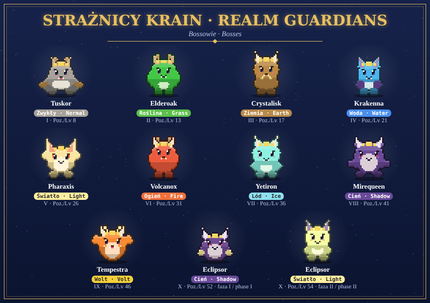

# Historia / Story
### LUMINA: Kroniki Dziesięciu Krain · Chronicles of the Ten Realms

**[Polski](#polski) · [English](#english)**

---

## Polski

### Prolog — świat, który świecił

Zanim ktokolwiek zaczął spisywać kroniki, świat nazywano po prostu **Lumina** — „ta, która świeci”. Rozciągał się od kwiecistych łąk na wschodzie po czarne wieże na zachodnim krańcu i dzielił się na **Dziesięć Krain**. Każda miała własne niebo, własną pieśń i własne serce: **Kryształ Światła**.

Kryształy nie były klejnotami, które można ukraść czy sprzedać. Były raczej oddechem świata. To dzięki nim słońce wiedziało, kiedy wstać, deszcz — kiedy spaść, a dzikie stworzenia — kiedy bawić się w trawie, a kiedy spać. Przy każdym Krysztale czuwał **strażnik krainy**: istota tak stara jak sama ziemia, związana z nią na dobre i na złe. Tuskor pilnował łąk, Elderoak śpiewał lasowi kołysanki, Krakenna prowadziła statki do portu, a Królowa Mokradeł leczyła tych, którzy zabłądzili we mgle.

Ludzie, którzy pomagali strażnikom, nazywali siebie **Strażnikami Płomienia**. Nie władali Kryształami — doglądali ich. W każdej krainie rozpalali **święte płomienie**: kapliczki, przy których wędrowiec mógł odpocząć, opatrzyć rany i zostawić ślad swojej drogi. Mówiono, że płomień pamięta każdego, kto przy nim spoczął, i potrafi przywołać go z powrotem nawet z najgłębszej ciemności.

### Pierwszy Strażnik

Na freskach pustynnych świątyń zachował się obraz, który niewielu potrafi dziś odczytać. Przedstawia postać z uniesionymi ramionami, w połowie złotą, w połowie czarną, stojącą pod niebem bez słońca. To **Pierwszy Strażnik** — ten, który zgasił *pierwsze* Zaćmienie.

Dawno temu, gdy ciemność po raz pierwszy przesłoniła niebo, żaden płomień nie potrafił jej rozproszyć. Pierwszy Strażnik zrobił więc coś, czego nikt przed nim się nie odważył: wchłonął mrok w siebie i zamknął go własnym światłem, jak pieczęcią. Niebo pojaśniało. Ludzie wiwatowali. Strażnik zamieszkał w twierdzy na granicy dnia i nocy — w **Cytadeli Zmierzchu** — i przez długie wieki strzegł tajemnicy, którą nosił w piersi.

Ale żadna pieczęć nie trwa wiecznie. Cień w jego sercu szeptał, że dziesięć Kryształów to dziesięć słabych punktów, dziesięć miejsc, w których świat może pęknąć. Że lepiej byłoby, gdyby całe światło miał w rękach jeden strażnik — ten jeden, który już raz ocalił świat. Pierwszy Strażnik słuchał tego szeptu coraz dłużej, aż w końcu przestał odróżniać go od własnych myśli.

Pewnej nocy sięgnął ku Kryształom i zaczął pić ich blask. Niebo nad Dziesięcioma Krainami zgasło — nie całkiem, lecz tak, jakby ktoś przysłonił słońce dłonią. Tak narodziło się **Zaćmienie**. A człowiek, który niegdyś je pokonał, przyjął nowe imię: **Eclipsor**. Od tamtej chwili ma dwie twarze — cień i światło — i obie są równie okrutne.

Zatrute Kryształy przygasły, a ich strażnicy oszaleli. Wciąż czuwali nad swoimi krainami, lecz nie pamiętali już, przed czym mają je chronić. Łagodne stworzenia zdziczały. Strażnicy Płomienia ruszyli na zachód, by stawić czoło Eclipsorowi — i jeden po drugim przepadali. Niektórzy, jak **Strażniczka Wanda**, nie zginęli, lecz upadli, a ciemność uczyniła z nich swoje sługi.

### Aldo i ostatni płomień

Z całego zakonu pozostał tylko **Aldo**, ostatni ze Strażników Płomienia. Był za stary, by walczyć, ale wystarczająco uparty, by czekać. Przez lata podsycał płomienie w kapliczkach, choć nikt już przy nich nie odpoczywał, i wypatrywał kogoś, kto zdoła zrobić to, czego nie potrafił sam zakon: nie zdobyć światło siłą, lecz *związać się więzią* ze stworzeniami krain i razem z nimi przywrócić blask.

Pewnego świtu, na skraju Łąk Świtu, znalazł śpiące dziecko. — *Obudź się, dziecko… Jestem Aldo, ostatni ze Strażników Płomienia* — powiedział. Tak zaczyna się ta kronika.

### Strażnik Ren i jego towarzysze

Młody wędrowiec nazywa się **Ren** i nie pamięta, skąd przybył. Aldo nazywa go **Strażnikiem**, choć Ren nigdy nie składał żadnej przysięgi. Starzec przyprowadza do niego trzy młode stworzenia, ostatnie, które nie poddały się dzikości:

- **Embrix** — mały, gorący jak węgielek stworek ognia, w którego łapach drzemie siła ziemi. Kiedyś stanie się **Pyrhoundem**, a w końcu ognistym **Infernyxem**.
- **Aquapup** — spokojny szczeniak wody o chłodnym, lodowym oddechu, który wyrośnie na **Tidaliska**, a potem na potężnego **Leviathorna**.
- **Leafin** — zwinny listek z iskrą światła w sercu; jako **Thornwing** nauczy się latać, a jako **Sylvagon** będzie świecić jak słońce przesiane przez liście.

— *Nie pójdziesz sam. Wybierz jedno z nich — odtąd będzie twoim towarzyszem* — mówi Aldo. Każda kronika jest trochę inna, bo każdy Strażnik wybiera inaczej. Ale każda kończy się tak samo: wspólną drogą przez dziesięć krain.

### Kroniki Dziesięciu Krain

**I. Łąki Świtu.** Pierwsze promienie kładą się na trawie, lecz w kępach czai się niepokój. Ren spotyka Młodego Kubę, który twierdzi, że każdy Strażnik musi zacząć od walki z nim, i Zielarkę Olę, która uczy go, że ogień pali rośliny. Na końcu łąk czeka **Tuskor** — dobroduszny niegdyś dzik, który ryje ziemię kłami i ryczy w gniewie, którego nie rozumie. Gdy pada, światło pierwszego Kryształu wraca do jego oczu, a w miejscu, gdzie stał, otwiera się portal.

**II. Szepczący Las.** Prastare drzewa szepczą o cieniu w korzeniach. Leśniczy Marek każe Renowi udowodnić, że potrafi las ocalić; Grzybiarka Basia próbuje go uśpić zarodnikami. W sercu boru gałęzie **Elderoaka** — Pradębu — trzeszczą jak kości. Kiedyś śpiewał lasowi kołysanki; dziś słychać tylko jęk. Po walce las milknie — ale tym razem jest to cisza snu, nie strachu.

**III. Kryształowe Jaskinie.** W głębi skał kryształy pulsują chorym, fioletowym blaskiem, a ciemność oddycha razem z wędrowcem. Górnik Staszek i Grotołazka Ewa przyznają, że nigdy nie widzieli takiej poświaty. **Crystalisk**, strażnik trzeciego Kryształu od tysiąca lat, rozkłada lśniące łuski — każda odbija strach tego, kto na nią patrzy. Ren uczy się, że w ciemnych korytarzach kapliczka jest jedynym pewnym światłem.

**IV. Wybrzeże Mew.** Fale biją o brzeg, a mewy krzyczą ostrzegawczo. Rybak Zbyszek walczy, bo ryby nie biorą, a Żeglarka Magda — bo wiatr jej sprzyja. Z głębin wynurza się **Krakenna**, która niegdyś prowadziła statki do portu, a teraz je zatapia. Jej macki oplatają skały, a morze ryczy jej głosem. Gdy czwarty Kryształ rozbłyska, fale po raz pierwszy od dawna niosą statki z powrotem do domu.

**V. Pustynia Słońca.** W rozgrzanym powietrzu drżą ruiny świątyń. Archeolożka Iza pokazuje Renowi freski z Pierwszym Strażnikiem i pyta półżartem, czy nie mają jego twarzy. Ren nie odpowiada. **Pharaxis** unosi złote skrzydła — jego blask oślepia, ale serce ma czarne. To tutaj Ren pojmuje, że nawet światło może zbłądzić.

**VI. Wulkan Popiołów.** Niebo zasnuł popiół, ziemia pęka od żaru, a serce wulkanu bije coraz szybciej. Kowal Bogdan hartuje stal w lawie, Ogniomistrzyni Kasia tańczy z płomieniami. **Volcanox** wyłania się z lawy, a skały topnieją pod jego krokami. Sześć Kryształów odzyskuje blask — i daleko na zachodzie Zaćmienie po raz pierwszy czuje, że ktoś się zbliża.

**VII. Mroźne Szczyty.** Lodowy wiatr wyje między sosnami, a śnieg zasypuje dawne szlaki. Alpinista Wojtek mówi, że ogień to najlepszy przyjaciel w górach, a Pustelniczka Hania, wyrwana z wieloletniej medytacji, przyznaje, że duch Rena płonie jak płomień. Na szczycie **Yetiron** uderza pięściami w lód i sprowadza lawinę — ale nawet lawina w końcu się zatrzymuje.

**VIII. Nawiedzone Mokradła.** Mgła kłębi się nad czarną wodą, a martwe drzewa wyciągają gałęzie. Tu Zaćmienie jest najsilniejsze. Medium Lucjan słyszy, jak duchy szepczą imię Rena; Wiedźma Jadwiga z niechęcią przyznaje, że światło wciąż w nim płonie. Z bagna unosi się **Królowa Mokradeł** w koronie z kości i szepcze: *„Dołącz do cienia…”*. Była kiedyś uzdrowicielką — Zaćmienie wykrzywiło jej dar. Gdy ósmy Kryształ rozbłyska, mgła po raz pierwszy się rozstępuje.

**IX. Wieża Niebios.** Kamienne mosty wiszą nad przepaścią chmur, a pioruny rozdzierają niebo. Lotnik Tadeusz i Burzowa Zosia sprawdzają, czy Ren wytrzyma wiatr. **Tempestra** rozkłada skrzydła z błyskawic i niebo drży. Kiedy burza wreszcie cichnie, ze szczytu wieży widać na horyzoncie czarne mury — **Cytadelę Zmierzchu**, miejsce, w którym narodziło się Zaćmienie.

**X. Cytadela Zmierzchu.** Czarne mury wchłaniają każdy promień. Drogę zastępuje Rycerz Cienia Roch, który przysięgał bronić Cytadeli „nawet przed tobą” — i który po walce zastanawia się, czy to nie Ren jest prawdziwym światłem. Dalej czeka **Upadła Strażniczka Wanda**. Kiedyś była jedną z tych, którzy ruszyli na Eclipsora; przegrała i od tamtej pory służyła ciemności. Gdy Ren ją pokonuje, mówi cicho: *„Dziękuję… czuję znów ciepło. Pokonaj go”*. Ostatnia kapliczka płonie tuż przed tronem. Ren odpoczywa przy niej, a płomień — jak zawsze — zapamiętuje jego drogę.

### Finał — dwie twarze Zaćmienia

Eclipsor czeka w sercu Cytadeli. *„Dziewięć Kryształów… i co z tego? Ja JESTEM Zaćmieniem!”* — woła i zasłania niebo.

Pierwsza twarz to **cień**: zimny, cierpliwy, uderzający Mrocznym Pulsem i Zaćmieniem — najstraszliwszym ciosem, jaki zna świat. Gdy ta twarz upada, Eclipsor nie ginie. **Odradza się w oślepiającym świetle** — bo przecież zawsze był w połowie złoty, jak na freskach. *„Prawdziwe zaćmienie dopiero się zaczyna!”*. Druga twarz to **światło**, ale światło bez ciepła: leczy własne rany i pali wszystko, czego dotknie.

Ren nie wygrywa sam. Wygrywa dzięki drużynie, którą zebrał w dziesięciu krainach — stworzeniom ognia i wody, cienia i światła, z których każde pamięta, jak to jest bawić się w trawie bez strachu. Tego Eclipsor nigdy nie rozumiał: światła nie da się utrzymać w jednych rękach. Trzeba się nim dzielić.

### Epilog — świt

Ostatni Kryształ rozbłysnął i Zaćmienie pękło jak szkło. Nad Dziesięcioma Krainami po raz pierwszy od lat wzeszło słońce.

Strażnicy krain odzyskali rozum. Tuskor znów pilnuje łąk, Elderoak znów śpiewa, Krakenna prowadzi statki do portu, a Królowa Mokradeł na powrót leczy zbłąkanych. Dzikie stworzenia bawią się w trawie, nie znając strachu. Mówią, że gdy pierwszy promień dotknął Cytadeli, na posadzce leżał tylko pęknięty, dwubarwny kamień — i że od tamtej pory jest w nim więcej złota niż czerni.

Aldo stanął obok Rena przy płonącej kapliczce. — *Dokonałeś tego. Płomień nie zgaśnie, dopóki ktoś taki jak ty o niego dba.*

Kronika dobiega końca… lecz każda kraina wciąż czeka, by ją odwiedzić. Święte płomienie płoną dalej. Może przy którymś z nich spotkasz kiedyś Rena — albo kogoś, kto, jak głoszą freski, ma jego twarz.

---

## English

### Prologue — a world that shone

Long before anyone began writing chronicles, the world was simply called **Lumina** — “she who shines”. It stretched from the flowering meadows of the east to the black towers at its western edge and was divided into **Ten Realms**. Each had its own sky, its own song and its own heart: a **Light Crystal**.

The Crystals were not jewels to be stolen or sold. They were more like the world's breath. Through them the sun knew when to rise, the rain when to fall, and wild creatures when to play in the grass and when to sleep. Beside each Crystal watched a **realm guardian**: a being as old as the land itself, bound to it for better or worse. Tuskor kept the meadows, Elderoak sang lullabies to the forest, Krakenna guided ships to harbor, and the Mire Queen healed those who lost their way in the fog.

The people who served the guardians called themselves the **Flamekeepers**. They did not rule the Crystals — they tended them. In every realm they kindled **sacred flames**: shrines where a traveller could rest, mend their wounds and leave a mark of their journey. It was said that a flame remembers everyone who ever rested beside it, and can call them back even from the deepest dark.

### The First Warden

On the murals of the desert temples survives an image few can read today. It shows a figure with raised arms, half golden and half black, standing beneath a sunless sky. It is the **First Warden** — the one who quelled the *first* Eclipse.

Long ago, when darkness first veiled the sky, no flame could drive it away. So the First Warden did what no one before had dared: drew the darkness into himself and sealed it with his own light. The sky brightened. The people cheered. The Warden made his home in a fortress on the border between day and night — the **Twilight Citadel** — and for long centuries guarded the secret he carried in his chest.

But no seal lasts forever. The shadow in his heart whispered that ten Crystals were ten weak points, ten places where the world could crack. That it would be better if all the light rested in the hands of a single keeper — the one who had already saved the world once. The First Warden listened to that whisper longer and longer, until he could no longer tell it apart from his own thoughts.

One night he reached out to the Crystals and began to drink their glow. The sky above the Ten Realms dimmed — not entirely, but as if a hand had been held before the sun. Thus the **Eclipse** was born. And the man who had once defeated it took a new name: **Eclipsor**. From that moment he has had two faces — shadow and light — and both are equally cruel.

The poisoned Crystals faded and their guardians went mad. They still watched over their realms, but no longer remembered what they were protecting them from. Gentle creatures grew wild. The Flamekeepers marched west to face Eclipsor — and one after another they vanished. Some, like **Wanda**, did not die but fell, and the darkness made them its servants.

### Aldo and the last flame

Of the whole order only **Aldo** remained, the last of the Flamekeepers. He was too old to fight but stubborn enough to wait. For years he tended the shrine flames, though no one rested by them anymore, watching for someone who could do what the order never could: not seize the light by force, but *bond* with the creatures of the realms and bring the light back together with them.

One dawn, at the edge of the Dawnlight Meadows, he found a sleeping child. “*Wake up, child… I am Aldo, the last of the Flamekeepers*,” he said. And so this chronicle begins.

### Warden Ren and the companions

The young wanderer is called **Ren** and does not remember where he came from. Aldo calls Ren a **Warden**, though Ren never swore any oath. The old man brings three young creatures, the last that have not given in to wildness:

- **Embrix** — a small fire creature, hot as an ember, with the strength of the earth sleeping in its paws. One day it will become **Pyrhound**, and finally the blazing **Infernyx**.
- **Aquapup** — a calm water pup with a cool, icy breath, who will grow into **Tidalisk** and then the mighty **Leviathorn**.
- **Leafin** — a nimble leaf with a spark of light in its heart; as **Thornwing** it will learn to fly, and as **Sylvagon** it will shine like sunlight through leaves.

“*You will not go alone. Choose one of them — from now on it will be your companion*,” says Aldo. Every chronicle is a little different, because every Warden chooses differently. But each one ends the same way: with a shared road through ten realms.

### Chronicles of the Ten Realms

**I. Dawnlight Meadows.** The first rays spill across the grass, yet unease stirs in the tufts. Ren meets Youngster Kuba, who insists every Warden must start by fighting him, and Herbalist Ola, who teaches that fire burns plants. At the end of the meadows waits **Tuskor** — once a good-natured boar — gouging the earth with its tusks and bellowing in a rage it cannot understand. When it falls, the light of the first Crystal returns to its eyes, and a portal opens where it stood.

**II. Whispering Woods.** Ancient trees whisper of a shadow in their roots. Ranger Marek asks Ren to prove he can save the woods; Forager Basia tries to put him to sleep with spores. At the heart of the forest **Elderoak**'s branches creak like bones. It once sang lullabies to the forest; now there is only moaning. After the battle the forest falls silent — but this time it is the silence of sleep, not of fear.

**III. Crystal Caverns.** Deep within the rock, crystals pulse with a sickly violet glow, and the darkness breathes along with the traveller. Miner Staszek and Spelunker Ewa admit they have never seen such a glow. **Crystalisk**, guardian of the third Crystal for a thousand years, spreads its glittering scales — each one reflecting the fear of whoever looks at it. Ren learns that in dark tunnels a shrine is the only sure light.

**IV. Gullwing Coast.** Waves pound the shore and gulls cry in warning. Fisherman Zbyszek battles because the fish aren't biting, Sailor Magda because the wind is with her. From the deep rises **Krakenna**, who once guided ships to harbor and now sinks them. Her tentacles coil around the rocks and the sea roars with her voice. When the fourth Crystal blazes, the waves carry ships home again for the first time in ages.

**V. Sunscar Desert.** Temple ruins shimmer in the heat. Archaeologist Iza shows Ren the murals of the First Warden and asks, half-jokingly, whether they bear his face. Ren does not answer. **Pharaxis** raises its golden wings — its radiance blinds, but its heart is black. Here Ren understands that even light can lose its way.

**VI. Ashen Volcano.** Ash veils the sky, the ground cracks with heat, and the volcano's heart beats ever faster. Smith Bogdan tempers steel in lava, Firedancer Kasia dances with flames. **Volcanox** rises from the lava, and stone melts beneath its steps. Six Crystals shine again — and far to the west, the Eclipse feels for the first time that someone is drawing near.

**VII. Frostpeak Heights.** An icy wind howls among the pines and snow buries the old trails. Climber Wojtek says fire is a climber's best friend, and Hermit Hania, roused from years of meditation, admits that Ren's spirit burns like a flame. On the summit **Yetiron** pounds the ice and brings down an avalanche — but even an avalanche must stop at last.

**VIII. Haunted Mire.** Fog coils above black water and dead trees reach out with their branches. Here the Eclipse is strongest. Medium Lucjan hears the spirits whisper Ren's name; Witch Jadwiga grudgingly admits that the light still burns in him. From the bog rises the **Mire Queen** in a crown of bone, whispering: *“Join the shadow…”* She was once a healer — the Eclipse twisted her gift. When the eighth Crystal blazes, the fog parts for the first time.

**IX. Skyward Spire.** Stone bridges hang above an abyss of clouds and lightning tears the sky apart. Aviator Tadeusz and Stormcaller Zosia test whether Ren can stand the wind. **Tempestra** spreads wings of lightning and the heavens tremble. When the storm finally calms, black walls appear on the horizon from the top of the spire — the **Twilight Citadel**, where the Eclipse was born.

**X. Twilight Citadel.** The black walls drink in every ray. Shadow Knight Roch bars the way, sworn to defend the Citadel “even from you” — and after the battle he wonders whether Ren is the true light. Beyond him waits **Fallen Warden Wanda**. She was once among those who marched against Eclipsor; she lost, and has served the darkness ever since. When Ren defeats her, she says quietly: *“Thank you… I feel warmth again. Defeat him.”* The last shrine burns just before the throne. Ren rests beside it, and the flame — as always — remembers his journey.

### Finale — the two faces of the Eclipse

Eclipsor waits at the heart of the Citadel. *“Nine Crystals… so what? I AM the Eclipse!”* he cries, and blots out the sky.

The first face is **shadow**: cold, patient, striking with Dark Pulse and Eclipse — the most terrible blow the world has known. When that face falls, Eclipsor does not die. **He is reborn in blinding light** — for he was always half golden, just as the murals show. *“The true eclipse is only beginning!”* The second face is **light**, but light without warmth: it heals its own wounds and burns everything it touches.

Ren does not win alone. He wins thanks to the team gathered across ten realms — creatures of fire and water, shadow and light, each of whom remembers what it is like to play in the grass without fear. That is what Eclipsor never understood: light cannot be held in a single pair of hands. It has to be shared.

### Epilogue — dawn

The last Crystal blazed and the Eclipse shattered like glass. For the first time in years, the sun rose over the Ten Realms.

The guardians of the realms regained their minds. Tuskor keeps the meadows again, Elderoak sings again, Krakenna guides ships to harbor, and the Mire Queen once more heals the lost. Wild creatures play in the grass, knowing no fear. They say that when the first ray touched the Citadel, only a cracked, two-coloured stone lay on the floor — and that ever since there has been more gold in it than black.

Aldo stood beside Ren at a burning shrine. “*You did it. The flame will never die while someone like you tends it.*”

The chronicle draws to a close… yet every realm still waits to be visited. The sacred flames burn on. Perhaps at one of them you will meet Ren someday — or someone who, as the murals say, bears his face.

---

Teksty w cudzysłowach pochodzą z gry (prolog, dialogi strażników, zakończenie). · Quoted lines come from the game itself (prologue, guardian lines, ending).
