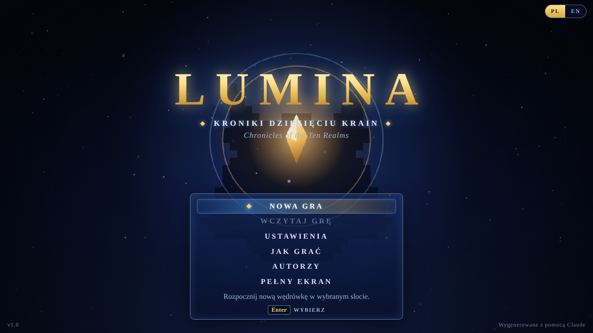
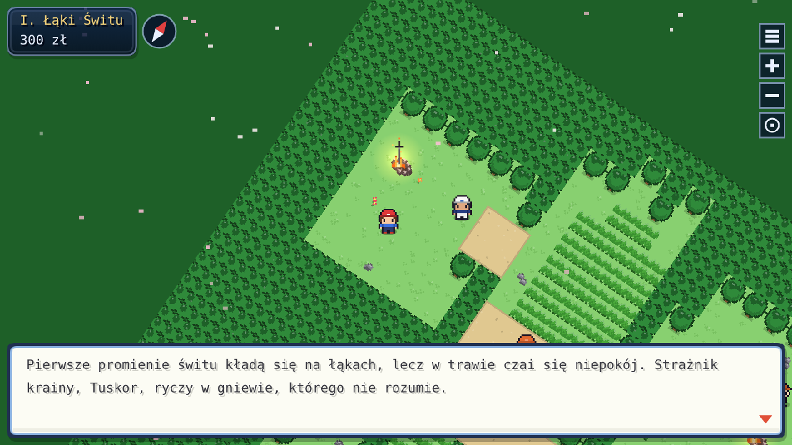
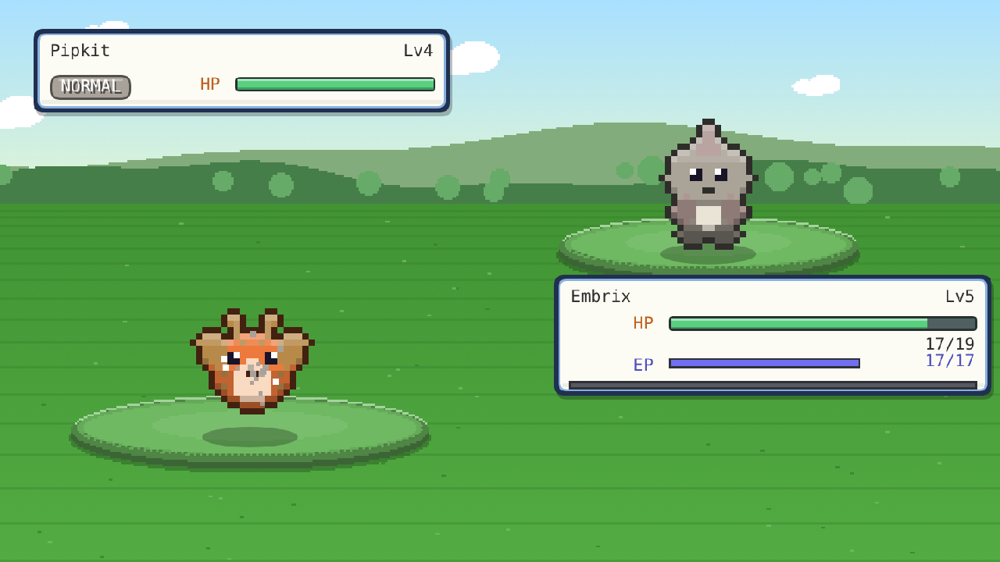
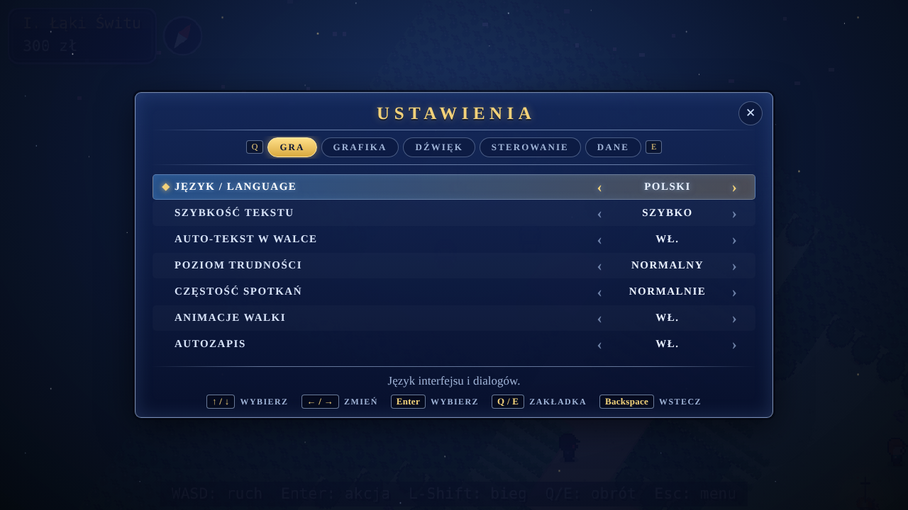
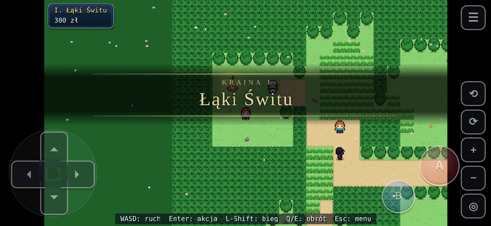
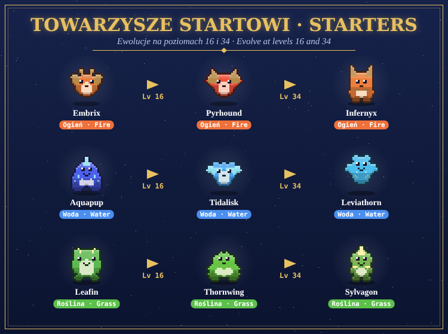

# Instrukcja gry / How to Play
### LUMINA: Kroniki Dziesięciu Krain · Chronicles of the Ten Realms

**[Polski](#polski) · [English](#english)**

## Zrzuty ekranu / Screenshots

| | |
|---|---|
|  |  |
| *Menu tytułowe · Title screen* | *Eksploracja krainy · Exploring a realm* |
|  |  |
| *Walka · Battle* | *Ustawienia · Settings* |
|  | |
| *Telefon z przyciskami dotykowymi · Phone with touch controls* | |

Zobacz też / See also: [Historia / Story](HISTORIA.md) · [Krainy / Realms](KRAINY.md)

---

## Polski

**Spis treści:** [Pierwsze kroki](#pl-start) · [Eksploracja](#pl-world) · [Walka](#pl-battle) · [Typy](#pl-types) · [Statusy](#pl-status) · [Łapanie](#pl-catch) · [Drużyna i schowek](#pl-party) · [Ewolucje](#pl-evo) · [Przedmioty i sklep](#pl-items) · [Kapliczki](#pl-shrines) · [Zapis](#pl-save) · [Śmierć](#pl-death) · [Postęp i portale](#pl-progress) · [Kamera](#pl-camera) · [Sterowanie](#pl-controls) · [Ustawienia](#pl-settings) · [Instalacja](#pl-install) · [FAQ](#pl-faq)

### Pierwsze kroki

1. **Ekran startowy** — naciśnij dowolny klawisz, kliknij lub dotknij ekranu. To pierwsze dotknięcie odblokowuje też dźwięk (przeglądarki nie pozwalają grać muzyki bez gestu użytkownika).
2. **Menu tytułowe** (styl Dark Souls, czarno-złote):
   - **Kontynuuj** — wraca do ostatnio używanego zapisu (widać krainę i czas gry),
   - **Nowa gra** — rozpoczyna nową wędrówkę w wybranym **slocie (1–5)**; zajęty slot trzeba potwierdzić do nadpisania,
   - **Wczytaj grę** — wybór jednego z 5 zapisów,
   - **Wybór krainy** — przeniesienie do już odblokowanej krainy (z ostatniego zapisu),
   - **Ustawienia**, **Jak grać**, **Autorzy**, **Pełny ekran**.
3. **Prolog** — Aldo, ostatni ze Strażników Płomienia, opowiada o Kryształach Światła i Zaćmieniu.
4. **Wybór towarzysza** — jedno z trzech stworzeń (na poziomie 5):

   | Starter | Typ | Ataki dodatkowe | Charakter |
   |---|---|---|---|
   | **Embrix** | Ogień | Ziemia | wysoki atak, szybki |
   | **Aquapup** | Woda | Lód | najwięcej PŻ i obrony |
   | **Leafin** | Roślina | Światło | zrównoważony, uczy się usypiania |

   
5. Na start dostajesz **300 zł**, **5 Mikstur**, **2 Etery**, **5 Kul Lumen** i **1 Panaceum**.

### Eksploracja

- Chodzisz po kafelkach w czterech kierunkach. **Bieg**: przytrzymaj Shift (pad: X albo przytrzymany B; dotyk: przytrzymaj B).
- **Zatwierdź** (Enter/Z/Spacja, A) przed postacią lub obiektem: rozmowa, otwarcie skrzyni, kapliczka, portal, walka z bossem.
- **Kliknij / dotknij kafelka**, a postać sama tam dojdzie (wyszukiwanie ścieżki). Kliknięcie postaci, skrzyni lub kapliczki — podejdzie i jej użyje.
- **Mieszkańcy**: opowiadacze legend (zapiski fabularne krainy), doradcy (porady), **sprzedawca** i **trenerzy**. Nad niepokonanym trenerem, gdy się zbliżysz, pojawia się czerwony wykrzyknik.
- **Skrzynie** zawierają złoto albo przedmioty; każdą otwiera się tylko raz.
- **Wysoka trawa** — tu czają się dzikie stworzenia. Po co najmniej 3 krokach w trawie każdy kolejny krok ma ok. 9% szansy na spotkanie (×0,5 przy ustawieniu „Rzadko”, ×1,7 przy „Często”). Poziom dzikich stworzeń zależy od krainy (zob. [Krainy](KRAINY.md)).
- **Menu pauzy** (Esc/C, Start/Y, ☰): Drużyna, Plecak, Bestiariusz, **Mapa** (podgląd całej krainy), Zapisz grę, Wczytaj grę, Ustawienia, Menu główne.
- W **Jaskiniach**, **Mokradłach** i **Cytadeli** jest ciemno — widzisz krąg światła wokół siebie, a kapliczki i portale świecą z daleka.

### Walka

Walki toczą się turowo, jedno stworzenie na jedno. Twoje stoi na bliższej platformie, przeciwnik na dalszej.

**Polecenia:**

| Polecenie | Działanie |
|---|---|
| **WALKA** | wybór jednego z (maks.) 4 ruchów; widać typ, **MOC**, **CEL.** (celność) i koszt **EP** |
| **PLECAK** | użycie przedmiotu lub rzut kulą (tylko dzikie stworzenia); zajmuje turę |
| **DRUŻYNA** | zmiana stworzenia; zajmuje turę |
| **UCIECZKA** | tylko z dzikimi; pewna, gdy jesteś szybszy, w przeciwnym razie szansa rośnie z każdą próbą. Od trenerów i bossów uciec się nie da |

**Kolejność ruchów** — najpierw ruch z wyższym **priorytetem** (Błysk / *Quick Dash* ma priorytet +1), potem szybsze stworzenie (paraliż połowi szybkość), przy remisie decyduje los.

**EP (energia)** — każdy ruch poza **Szarżą** kosztuje EP (3 za słabe, 5 za średnie, 9 za najsilniejsze, 10 za Zaćmienie; ruchy statusowe 3–6). Maksymalne EP = 12 + poziom. EP nie odnawia się w trakcie walki — przywraca je Eter, Eliksir Pełni, kapliczka i (częściowo) awans. Gdy zabraknie EP na wszystkie ruchy, stworzenie atakuje Szarżą „resztką sił”. Przeciwnicy nie zużywają EP.

**Obrażenia** zależą od poziomu, mocy ruchu, ataku i obrony. Mnożniki:
- **Bonus typu (STAB) ×1,5** — gdy ruch ma typ stworzenia lub jego typ ataków dodatkowych (np. Embrix: Ogień i Ziemia),
- **skuteczność typu** ×2 / ×1 / ×0,5,
- **trafienie krytyczne** — szansa 1/16, obrażenia ×1,5,
- losowo 85–100%,
- **etapy wzmocnień** od −2 do +2: ×0,5 / ×0,67 / ×1 / ×1,5 / ×2 (Skupienie: atak +1, Utwardzenie: obrona +1, Ryk: obrona celu −1). Wzmocnienia znikają przy zmianie stworzenia i po walce.

**Doświadczenie** — stworzenia, które walczyły, dostają pełne PD, a reszta przytomnej drużyny połowę. Walki z trenerami i bossami dają ×1,5 PD. Poziom trudności: łatwy ×1,4 PD, trudny ×0,9. Złoto dostajesz tylko od trenerów i bossów.

### Typy i skuteczność

9 typów: **Zwykły, Ogień, Woda, Roślina, Wolt, Lód, Ziemia, Cień, Światło**. Wiersz = typ ataku, kolumna = typ obrońcy. **2** = super skuteczne, **½** = mało skuteczne, puste = ×1. W grze nie ma pełnych odporności (×0).

| Atak ↓ / Obrońca → | Zwy | Ogi | Wod | Roś | Wol | Lód | Zie | Cie | Świ |
|---|:-:|:-:|:-:|:-:|:-:|:-:|:-:|:-:|:-:|
| **Zwykły** | | | | | | | | | |
| **Ogień** | | ½ | ½ | **2** | | **2** | ½ | | |
| **Woda** | | **2** | ½ | ½ | | | **2** | | |
| **Roślina** | | ½ | **2** | ½ | | ½ | **2** | | |
| **Wolt** | | | **2** | | ½ | | ½ | | |
| **Lód** | | ½ | | **2** | | ½ | **2** | | |
| **Ziemia** | | **2** | ½ | ½ | **2** | | | | |
| **Cień** | | | | | | | | ½ | **2** |
| **Światło** | | | | | | | | **2** | ½ |

Skrót: ogień pali rośliny i lód; woda gasi ogień i podmywa ziemię; rośliny piją wodę i kruszą ziemię; wolt razi wodę, ale ziemia go uziemia; lód mrozi rośliny i ziemię; cień i światło ranią się nawzajem.

### Statusy

| Status | Skrót | Efekt | Odporny typ | Źródła |
|---|---|---|---|---|
| **Oparzenie** | OPA | −1/16 maks. PŻ na koniec tury, atak ×0,75 | Ogień | Iskra Żaru, Wybuch Płomieni, Piekło, Rozbłysk Słońca |
| **Zatrucie** | TRU | −1/8 maks. PŻ na koniec tury | Cień | Toksyna, Mroczny Puls |
| **Paraliż** | PAR | szybkość ×0,5, 25% szans na utratę tury | Wolt | Iskra, Grom Wolt, Huk Gromu |
| **Sen** | SEN | brak ruchu przez 1–3 tury | — | Usypiające Zarodniki |
| **Zamrożenie** | ZAM | brak ruchu przez 1–2 tury | Lód | Odmrożenie, Lodowa Włócznia, Zamieć |

Stworzenie może mieć tylko jeden status naraz. Statusy zostają po walce — leczy je **Panaceum**, **Wskrzeszenie** (dla omdlałych) albo odpoczynek przy **kapliczce**.

### Łapanie

Dzikie stworzenie łapiesz, rzucając kulą z **Plecaka**. Stworzeń trenerów i bossów złapać się nie da.

**Szansa = podatność gatunku × moc kuli × (1 − ⅔ × PŻ/maks.PŻ) × 1,5 (jeśli ma status)**

| Kula | Moc | Cena | W sklepie od |
|---|---|---|---|
| **Kula Lumen** | ×1 | 40 zł | I |
| **Wielka Kula** | ×1,75 | 120 zł | IV |
| **Kula Zenitu** | ×2,5 | 250 zł | VII |

Podatność gatunków wynosi od 0,65 (Pipkit) do 0,25 (Duskknight, Voidling). Przykład: Pipkit z pełnym PŻ i Kulą Lumen — ok. 22%; z 10% PŻ — ok. 61%; z 10% PŻ i uśpiony — ok. 91%. Im więcej wstrząsów kuli, tym byłeś bliżej. Złapane stworzenie trafia do drużyny albo — gdy masz już 6 — do **schowka**, i zostaje wpisane do **Bestiariusza**.

### Drużyna i schowek

- Drużyna liczy **do 6 stworzeń**; pierwsze na liście wychodzi do walki jako prowadzące.
- **Menu pauzy → Drużyna**: podsumowanie (statystyki, ruchy, PD), ustaw jako prowadzące, zamień kolejność, przenieś do schowka, użyj przedmiotu.
- **Schowek** (nieograniczony) otwierasz przy kapliczce: wymieniaj stworzenia między schowkiem a drużyną.
- **Bestiariusz** pokazuje gatunki spotkane i złapane. Wszystkie gatunki: [img/creatures.png](img/creatures.png).
- Każde stworzenie zna maksymalnie **4 ruchy**. Nowy ruch z awansu zastępuje automatycznie najsłabszy (o ile nowy jest lepszy).

### Ewolucje

Ewolucja następuje **po walce**, w której stworzenie osiągnęło wymagany poziom.

| Linia | Poz. 16 | Poz. 34 |
|---|---|---|
| Embrix (Ogień) | → **Pyrhound** | → **Infernyx** |
| Aquapup (Woda) | → **Tidalisk** | → **Leviathorn** |
| Leafin (Roślina) | → **Thornwing** | → **Sylvagon** |

Dzikie ewolucje: **Fluffet → Fluffaroo** (Poz. 18), **Buzzle → Voltbuzz** (Poz. 20), **Rocklet → Bouldron** (Poz. 25).

Ruchy linii startowych (każda forma uczy się tych samych):

| Poz. | Embrix · Pyrhound · Infernyx | Aquapup · Tidalisk · Leviathorn | Leafin · Thornwing · Sylvagon |
|---|---|---|---|
| 1 | Szarża, Iskra Żaru | Szarża, Bąbelki | Szarża, Cięcie Liściem |
| 6 | Skupienie | Utwardzenie | Skupienie |
| 12 | Wybuch Płomieni | Wodny Strumień | Smagnięcie Pnączem |
| 19 | Rzut Kamykiem | Odmrożenie | Błysk Światła |
| 26 | Ryk | Ryk | Usypiające Zarodniki |
| 33 | Piekło | Fala Przypływu | Słoneczne Ostrze |
| 40 | Lawina Błota | Lodowa Włócznia | Promienistość |
| 48 | Wstrząs | Zamieć | Rozbłysk Słońca |

### Przedmioty i sklep

| Przedmiot | Efekt | Cena | W sklepie od krainy |
|---|---|---|---|
| **Mikstura** | +50 PŻ | 30 zł | I |
| **Supermikstura** | +150 PŻ | 90 zł | III |
| **Eliksir Pełni** | pełne PŻ i EP | 300 zł | VII |
| **Eter** | +15 EP | 60 zł | I |
| **Wskrzeszenie** | ożywia omdlałe stworzenie z połową PŻ | 200 zł | III |
| **Panaceum** | leczy każdy status | 40 zł | I |
| **Kula Lumen** | łapanie ×1 | 40 zł | I |
| **Wielka Kula** | łapanie ×1,75 | 120 zł | IV |
| **Kula Zenitu** | łapanie ×2,5 | 250 zł | VII |

**Sklep** prowadzi sprzedawca w każdej krainie. Kupujesz po 1, 5 lub 10 sztuk; **sprzedajesz za połowę ceny**. Im dalsza kraina, tym bogatszy towar. Przedmioty (oprócz kul) używasz z **Plecaka** w świecie albo w walce.

### Kapliczki (święte płomienie)

Kapliczki to ogniska w klimacie Dark Souls. Podejdź i zatwierdź, aby **odpocząć**:
- cała drużyna odzyskuje PŻ i EP, statusy znikają,
- gra **zapisuje się** w bieżącym slocie, a kapliczka staje się **punktem powrotu** po śmierci,
- przy pierwszym odpoczynku pojawia się napis **PŁOMIEŃ ROZPALONY**.

Menu kapliczki: **Odpocznij** (ponowne leczenie i zapis) · **Schowek** · **Podróż** (szybka podróż do dowolnej odblokowanej krainy) · **Odejdź**.

### Zapis i wczytywanie

- **5 slotów zapisu.** Każdy pokazuje krainę, prowadzące stworzenie, poziom, liczbę oczyszczonych krain i czas gry.
- **Autozapis** (Ustawienia → Gra) zapisuje grę po wygranej z trenerem, otwarciu skrzyni, pokonaniu bossa itp. Odpoczynek przy kapliczce **zawsze** zapisuje grę.
- **Ręczny zapis**: Menu pauzy → **Zapisz grę** (w dowolnym miejscu).
- **Eksport / import**: Ustawienia → **Dane** → przy każdym slocie *Eksport* (pobiera plik `lumina-save-N.json`), *Import* (wczytuje plik do slotu) i *Usuń*. Tak przeniesiesz grę między telefonem a komputerem albo zrobisz kopię zapasową.
- Zapisy przechowywane są w pamięci przeglądarki (localStorage). **Wyczyszczenie danych witryny usuwa zapisy** — zrób wcześniej eksport.

### Śmierć — „POLEGŁEŚ”

Gdy wszystkie stworzenia w drużynie zemdleją, na ekranie pojawia się czerwony napis **POLEGŁEŚ**. Wtedy:
- tracisz **połowę złota**,
- drużyna zostaje w pełni uleczona,
- wracasz do **ostatniej kapliczki**, przy której odpoczywałeś (albo na start krainy).

Przedmioty, złapane stworzenia i zdobyte poziomy zostają. Pokonani trenerzy i otwarte skrzynie — też.

### Postęp krain i portale

- Każdą krainę strzeże **boss** — oszalały strażnik Kryształu. Stoi w głębi mapy, otoczony fioletową aurą; walkę rozpoczynasz, podchodząc i zatwierdzając.
- Po zwycięstwie: napis **KRAINA OCZYSZCZONA**, Kryształ znów lśni (*n*/10), a **w miejscu bossa otwiera się portal**. Wejdź do niego, aby przejść do następnej krainy (nowa kraina zostaje odblokowana na stałe).
- Do wcześniejszych krain wrócisz przez **Podróż** przy kapliczce lub **Wybór krainy** w menu tytułowym.
- W **Cytadeli Zmierzchu** finałowy boss ma **dwie fazy**. Po zwycięstwie ostatni portal prowadzi do **zakończenia** i napisów końcowych. Szczegóły: [Krainy](KRAINY.md).

### Kamera

- **Obrót o pełne 360°** — płynnie, w obie strony: Q/E, LB/RB, prawy przycisk myszy + przeciąganie (albo Ctrl/Shift + lewy przycisk), dwa palce (gest obrotu), prawa gałka w poziomie, przyciski ⟲ ⟳ na ekranie dotykowym. Czerwona igła kompasu w rogu pokazuje północ.
- **Zoom 0,5×–3×** — kółko myszy (względem kursora), +/−, LT/RT, szczypanie, prawa gałka w pionie, przyciski +/−.
- **Przesuwanie** — przeciąganie lewym przyciskiem myszy lub jednym palcem. Kamera wraca do gracza, gdy ruszysz postacią.
- **Reset kamery** — R, L3/Select, ◎, podwójne kliknięcie/stuknięcie mapy albo przycisk w HUD (przy grze myszą po prawej stronie są przyciski menu, +, − i reset).
- Opcja **Ruch względem kamery** (domyślnie wł.) sprawia, że po obróceniu mapy „góra” nadal znaczy górę ekranu.

### Sterowanie

> **Wszystkie klawisze (po 2 na akcję) i przyciski pada można dowolnie zmienić** w *Ustawienia → Sterowanie*: wybierz pole i naciśnij nowy klawisz/przycisk (Esc anuluje, Delete czyści). Są też przyciski *Przywróć klawisze* i *Przywróć przyciski pada*.

**Klawiatura (domyślnie)**

| Akcja | Klawisz 1 | Klawisz 2 |
|---|---|---|
| Góra / Dół / Lewo / Prawo | ↑ ↓ ← → | W S A D |
| Zatwierdź / rozmowa | Enter | Z (oraz Spacja) |
| Anuluj / wstecz | Backspace | X |
| Menu (pauza) | Esc | C |
| Bieg (przytrzymaj) | lewy Shift | prawy Shift |
| Obrót kamery ← / → | Q / E | — |
| Przybliż / Oddal | = (+) / − | Num + / Num − |
| Reset kamery | R | — |

**Mysz**

| Gest | Działanie |
|---|---|
| Lewy klik na mapie | idź w to miejsce; na postaci/skrzyni/kapliczce — podejdź i użyj |
| Przeciąganie lewym | przesuwanie kamery |
| Przeciąganie prawym (lub Ctrl/Shift + lewym) | obrót kamery 360° |
| Kółko | zoom (względem kursora) |
| Podwójny klik | reset kamery |
| Przyciski HUD po prawej | menu, +, −, reset kamery |
| W menu | najechanie zaznacza, klik wybiera, kółko przewija, prawy klik = wstecz |

**Dotyk (telefon / tablet)**

| Element | Działanie |
|---|---|
| Krzyżak (lewa strona) | ruch |
| **A** | zatwierdź / rozmowa |
| **B** | wstecz; **przytrzymany — bieg** |
| **☰** | menu pauzy |
| ⟲ ⟳ + − ◎ | obrót, zoom, reset kamery |
| Stuknięcie mapy | idź tam |
| Przeciąganie jednym palcem | przesuwanie kamery |
| Dwa palce: szczypanie / obrót | zoom / obrót kamery |
| Podwójne stuknięcie | reset kamery |

W trybie leworęcznym krzyżak i przyciski zamieniają się stronami. Rozmiar i przezroczystość przycisków ustawisz w opcjach.

**Pad (Standard Gamepad, domyślnie)**

| Akcja | Przycisk 1 | Przycisk 2 |
|---|---|---|
| Ruch | krzyżak | lewa gałka |
| Zatwierdź | A | — |
| Wstecz (przytrzymany — bieg) | B | — |
| Bieg | X | — |
| Menu | Start | Y |
| Obrót kamery ← / → | LB / RB | prawa gałka ← → |
| Przybliż / Oddal | RT / LT | prawa gałka ↑ ↓ |
| Reset kamery | L3 | Select |

Martwą strefę gałek (10–60%) i wibracje pada ustawisz w opcjach. Pad wykrywa się po naciśnięciu dowolnego przycisku.

### Ustawienia (przegląd)

| Zakładka | Opcje |
|---|---|
| **Gra** | Język (PL/EN) · Szybkość tekstu (wolno / normalnie / szybko / natychmiast) · Auto‑tekst w walce · Poziom trudności (łatwy / normalny / trudny) · Częstość spotkań (rzadko / normalnie / często) · Animacje walki · Autozapis |
| **Grafika** | Rozdzielczość renderu (auto, 480×270, 960×540, 1440×810, 1920×1080) · Skalowanie (dopasuj / całkowite / rozciągnij) · Pełny ekran · Jasność (50–150%) · Wstrząsy ekranu · Linie CRT · Cząsteczki · Licznik FPS |
| **Dźwięk** | Głośność główna · Muzyka · Efekty · Wycisz w tle · Własna muzyka (pliki z `music/tracks.json`) · Test dźwięku |
| **Sterowanie** | Podpowiedzi sterowania (auto / klawiatura / pad / dotyk / mysz) · Sterowanie dotykowe (auto / zawsze / nigdy) · Rozmiar i przezroczystość przycisków · Tryb leworęczny · Wibracje · Kliknij, by iść · Kamera myszą · Odwróć przybliżanie · Ruch względem kamery · Szybkość obrotu (1–4) · Martwa strefa gałki · Wibracje pada · Podłączony pad · **przypisania klawiatury** · **przypisania pada** |
| **Dane** | Sloty 1–5: Eksport / Import / Usuń · Przywróć ustawienia (zapisy zostają) |

Poziom trudności: **łatwy** — przeciwnicy ×0,85, PD ×1,4, złoto ×1,2; **normalny** — ×1; **trudny** — przeciwnicy ×1,15, PD ×0,9, złoto ×0,9.

### Instalacja

**Android**
- **APK:** pobierz [lumina-kroniki.apk](https://github.com/jakubandroid31-create/lumina-kroniki/releases/latest/download/lumina-kroniki.apk), otwórz plik i zezwól na instalację z nieznanego źródła.
- **Bez APK:** otwórz [grę](https://jakubandroid31-create.github.io/lumina-kroniki/) w Chrome → menu ⋮ → **Zainstaluj aplikację** / **Dodaj do ekranu głównego**.

**iPhone / iPad**
- Otwórz grę w **Safari** → **Udostępnij** → **Do ekranu początkowego**. Uruchomiona z ikony działa na pełnym ekranie i offline.

**Komputer (Windows / macOS / Linux)**
- Otwórz grę w Chrome, Edge lub Firefoksie. W Chrome/Edge możesz ją „zainstalować” ikoną w pasku adresu — otworzy się w osobnym oknie. Pełny ekran: menu tytułowe lub Ustawienia → Grafika (albo F11).

Po pierwszym uruchomieniu gra działa **offline**.

### FAQ i rozwiązywanie problemów

**Nie ma dźwięku.** Przeglądarki odtwarzają dźwięk dopiero po pierwszym geście — dotknij ekranu lub naciśnij klawisz na ekranie startowym. Sprawdź suwaki w *Ustawienia → Dźwięk* i to, czy karta nie jest wyciszona. Na iPhonie dźwięk Web Audio bywa wyciszany przełącznikiem trybu cichego.

**Na iPhonie nie działa pełny ekran.** Safari na iPhonie nie obsługuje trybu pełnoekranowego dla stron. Dodaj grę do ekranu początkowego (Udostępnij → *Do ekranu początkowego*) i uruchamiaj ją z ikony.

**Nie widzę przycisków dotykowych / widzę je na komputerze.** *Ustawienia → Sterowanie → Sterowanie dotykowe*: **Zawsze** lub **Nigdy** (Auto pokazuje je tylko na urządzeniach dotykowych).

**Pad nie działa.** Naciśnij dowolny przycisk na padzie — przeglądarka udostępnia pad dopiero po pierwszym naciśnięciu. Nazwa pada pojawi się w ustawieniach. Jeśli przyciski są „pomieszane”, przypisz je na nowo.

**Gra nie aktualizuje się do najnowszej wersji.** Gra jest zapisywana w pamięci podręcznej (service worker). Zamknij wszystkie karty z grą i otwórz ją ponownie (czasem trzeba dwa razy). Jeśli to nie pomaga: w Chrome *Ustawienia witryny → Wyczyść dane*, w Safari *Ustawienia → Safari → Zaawansowane → Dane witryn*. **Uwaga: wyczyszczenie danych usuwa też zapisy — najpierw je wyeksportuj.**

**Obraz jest rozmyty albo piksele są nierówne.** Wybierz *Skalowanie: Całkowite* albo wyższą rozdzielczość renderu.

**Gra działa wolno.** Zmniejsz rozdzielczość renderu, wyłącz cząsteczki i linie CRT, w walce wyłącz animacje.

**Jak przenieść zapis na inne urządzenie?** *Ustawienia → Dane → Eksport* na starym urządzeniu, prześlij plik `.json`, a na nowym *Import* do wybranego slotu.

**Utknąłem na bossie.** Sprawdź słabości strażnika w [Krainach](KRAINY.md), wróć do trawy po kilka poziomów, złap stworzenie o korzystnym typie i kup Panacea.

---

## English

**Contents:** [Getting started](#en-start) · [Exploration](#en-world) · [Battle](#en-battle) · [Types](#en-types) · [Statuses](#en-status) · [Catching](#en-catch) · [Party & box](#en-party) · [Evolution](#en-evo) · [Items & shop](#en-items) · [Shrines](#en-shrines) · [Saving](#en-save) · [Death](#en-death) · [Progress & portals](#en-progress) · [Camera](#en-camera) · [Controls](#en-controls) · [Settings](#en-settings) · [Installing](#en-install) · [FAQ](#en-faq)

### Getting started

1. **Splash screen** — press any key, click or tap. That first touch also unlocks sound (browsers do not allow audio before a user gesture).
2. **Title menu** (Dark Souls style, black and gold):
   - **Continue** — returns to the most recently used save (shows the realm and play time),
   - **New Game** — starts a new journey in a chosen **save slot (1–5)**; an occupied slot must be confirmed before overwriting,
   - **Load Game** — pick one of 5 saves,
   - **Realm Select** — jump to an already unlocked realm (from the latest save),
   - **Settings**, **How to Play**, **Credits**, **Fullscreen**.
3. **Prologue** — Aldo, the last of the Flamekeepers, tells of the Light Crystals and the Eclipse.
4. **Choose your companion** — one of three creatures (level 5):

   | Starter | Type | Extra move type | Style |
   |---|---|---|---|
   | **Embrix** | Fire | Earth | high attack, fast |
   | **Aquapup** | Water | Ice | most HP and defense |
   | **Leafin** | Grass | Light | balanced, learns Sleep Spore |

   
5. You start with **300 G**, **5 Potions**, **2 Ethers**, **5 Lumen Orbs** and **1 Cure-All**.

### Exploration

- You move tile by tile in four directions. **Run**: hold Shift (gamepad: X or hold B; touch: hold B).
- **Confirm** (Enter/Z/Space, A) facing a person or object: talk, open a chest, use a shrine, a portal, challenge the boss.
- **Click / tap a tile** and your character walks there (pathfinding). Clicking a person, chest or shrine walks up and uses it.
- **Residents**: lore keepers (the realm's story notes), advisors (tips), the **shopkeeper** and **trainers**. A red exclamation mark appears above an undefeated trainer when you come close.
- **Chests** hold gold or items; each opens only once.
- **Tall grass** — wild creatures lurk here. After at least 3 steps in grass, each further step has about a 9% encounter chance (×0.5 on “Rare”, ×1.7 on “Frequent”). Wild levels depend on the realm (see [Realms](KRAINY.md)).
- **Pause menu** (Esc/C, Start/Y, ☰): Team, Bag, Bestiary, **Map** (whole-realm overview), Save game, Load game, Settings, Title screen.
- The **Caverns**, **Mire** and **Citadel** are dark — you see a circle of light around you, and shrines and portals glow from afar.

### Battle

Battles are turn-based, one creature against one. Yours stands on the near platform, the opponent on the far one.

**Commands:**

| Command | What it does |
|---|---|
| **FIGHT** | choose one of (up to) 4 moves; shows type, **POW**, **ACC** (accuracy) and **EP** cost |
| **BAG** | use an item or throw an orb (wild creatures only); takes your turn |
| **TEAM** | switch creatures; takes your turn |
| **RUN** | wild battles only; guaranteed if you are faster, otherwise the chance grows with each attempt. You cannot flee from trainers or bosses |

**Turn order** — the move with higher **priority** goes first (Quick Dash has +1 priority), then the faster creature (paralysis halves speed); ties are random.

**EP (energy)** — every move except **Tackle** costs EP (3 for weak, 5 for medium, 9 for the strongest, 10 for Eclipse; status moves 3–6). Max EP = 12 + level. EP does not regenerate during battle — Ethers, the Max Elixir, shrines and (partly) level-ups restore it. When no move is affordable, the creature “struggles on” with Tackle. Opponents do not spend EP.

**Damage** depends on level, move power, attack and defense. Multipliers:
- **Same-type bonus (STAB) ×1.5** — when the move matches the creature's type or its extra move type (e.g. Embrix: Fire and Earth),
- **type effectiveness** ×2 / ×1 / ×0.5,
- **critical hit** — 1/16 chance, ×1.5 damage,
- random 85–100%,
- **stat stages** from −2 to +2: ×0.5 / ×0.67 / ×1 / ×1.5 / ×2 (Focus: attack +1, Harden: defense +1, Roar: target's defense −1). Stages reset when switching out and after battle.

**Experience** — creatures that took part get full EXP, the rest of the conscious team gets half. Trainer and boss battles give ×1.5 EXP. Difficulty: Easy ×1.4 EXP, Hard ×0.9. Gold comes only from trainers and bosses.

### Types and effectiveness

9 types: **Normal, Fire, Water, Grass, Volt, Ice, Earth, Shadow, Light**. Row = attacking type, column = defending type. **2** = super effective, **½** = not very effective, blank = ×1. There are no full immunities (×0).

| Attack ↓ / Defender → | Nor | Fir | Wat | Gra | Vol | Ice | Ear | Sha | Lig |
|---|:-:|:-:|:-:|:-:|:-:|:-:|:-:|:-:|:-:|
| **Normal** | | | | | | | | | |
| **Fire** | | ½ | ½ | **2** | | **2** | ½ | | |
| **Water** | | **2** | ½ | ½ | | | **2** | | |
| **Grass** | | ½ | **2** | ½ | | ½ | **2** | | |
| **Volt** | | | **2** | | ½ | | ½ | | |
| **Ice** | | ½ | | **2** | | ½ | **2** | | |
| **Earth** | | **2** | ½ | ½ | **2** | | | | |
| **Shadow** | | | | | | | | ½ | **2** |
| **Light** | | | | | | | | **2** | ½ |

In short: fire burns plants and ice; water douses fire and erodes earth; plants drink water and crack earth; volt shocks water but earth grounds it; ice freezes plants and earth; shadow and light wound each other.

### Status conditions

| Status | Tag | Effect | Immune type | Sources |
|---|---|---|---|---|
| **Burn** | BRN | −1/16 max HP at end of turn, attack ×0.75 | Fire | Ember, Flame Burst, Inferno, Sunflare |
| **Poison** | PSN | −1/8 max HP at end of turn | Shadow | Toxin, Dark Pulse |
| **Paralysis** | PAR | speed ×0.5, 25% chance to lose the turn | Volt | Spark, Volt Bolt, Thunderclap |
| **Sleep** | SLP | cannot act for 1–3 turns | — | Sleep Spore |
| **Freeze** | FRZ | cannot act for 1–2 turns | Ice | Frostbite, Ice Lance, Blizzard |

A creature can have only one status at a time. Statuses persist after battle — cure them with a **Cure-All**, a **Revive** (for fainted creatures) or by resting at a **shrine**.

### Catching

Catch a wild creature by throwing an orb from the **Bag**. Trainers' creatures and bosses cannot be caught.

**Chance = species catch rate × orb power × (1 − ⅔ × HP/maxHP) × 1.5 (if it has a status)**

| Orb | Power | Price | In shops from |
|---|---|---|---|
| **Lumen Orb** | ×1 | 40 G | I |
| **Great Orb** | ×1.75 | 120 G | IV |
| **Zenith Orb** | ×2.5 | 250 G | VII |

Species catch rates range from 0.65 (Pipkit) down to 0.25 (Duskknight, Voidling). Example: a full-HP Pipkit with a Lumen Orb — about 22%; at 10% HP — about 61%; at 10% HP and asleep — about 91%. The more times the orb shakes, the closer you were. A caught creature joins your team or — if you already have 6 — goes to the **box**, and is recorded in the **Bestiary**.

### Party and box

- Your team holds **up to 6 creatures**; the first one leads in battle.
- **Pause menu → Team**: summary (stats, moves, EXP), set as lead, swap order, send to box, use an item.
- The **box** (unlimited) is opened at a shrine: exchange creatures between the box and your team.
- The **Bestiary** lists species seen and caught. All species: [img/creatures.png](img/creatures.png).
- Each creature knows at most **4 moves**. A move learned on level-up automatically replaces the weakest one (if the new move is better).

### Evolution

Evolution happens **after the battle** in which the creature reached the required level.

| Line | Lv 16 | Lv 34 |
|---|---|---|
| Embrix (Fire) | → **Pyrhound** | → **Infernyx** |
| Aquapup (Water) | → **Tidalisk** | → **Leviathorn** |
| Leafin (Grass) | → **Thornwing** | → **Sylvagon** |

Wild evolutions: **Fluffet → Fluffaroo** (Lv 18), **Buzzle → Voltbuzz** (Lv 20), **Rocklet → Bouldron** (Lv 25).

Starter line moves (every stage learns the same set):

| Lv | Embrix · Pyrhound · Infernyx | Aquapup · Tidalisk · Leviathorn | Leafin · Thornwing · Sylvagon |
|---|---|---|---|
| 1 | Tackle, Ember | Tackle, Bubble | Tackle, Leaf Cut |
| 6 | Focus | Harden | Focus |
| 12 | Flame Burst | Aqua Jet | Vine Lash |
| 19 | Pebble Toss | Frostbite | Glint |
| 26 | Roar | Roar | Sleep Spore |
| 33 | Inferno | Tidal Wave | Solar Blade |
| 40 | Mudslide | Ice Lance | Radiance |
| 48 | Quake | Blizzard | Sunflare |

### Items and shop

| Item | Effect | Price | In shops from realm |
|---|---|---|---|
| **Potion** | +50 HP | 30 G | I |
| **Super Potion** | +150 HP | 90 G | III |
| **Max Elixir** | full HP and EP | 300 G | VII |
| **Ether** | +15 EP | 60 G | I |
| **Revive** | revives a fainted creature with half HP | 200 G | III |
| **Cure-All** | cures any status | 40 G | I |
| **Lumen Orb** | catch ×1 | 40 G | I |
| **Great Orb** | catch ×1.75 | 120 G | IV |
| **Zenith Orb** | catch ×2.5 | 250 G | VII |

Every realm has a **shopkeeper**. Buy in quantities of 1, 5 or 10; **sell for half price**. The further the realm, the better the stock. Use items (other than orbs) from the **Bag** in the world or in battle.

### Shrines (sacred flames)

Shrines are Dark Souls–style bonfires. Walk up and confirm to **rest**:
- your whole team recovers HP and EP and is cured of statuses,
- the game **saves** to the current slot and the shrine becomes your **respawn point**,
- the first time you rest you see **FLAME KINDLED**.

Shrine menu: **Rest** (heal and save again) · **Box** · **Travel** (fast travel to any unlocked realm) · **Leave**.

### Saving and loading

- **5 save slots.** Each shows the realm, lead creature, level, number of cleansed realms and play time.
- **Autosave** (Settings → Game) saves after beating a trainer, opening a chest, defeating a boss and so on. Resting at a shrine **always** saves.
- **Manual save**: Pause menu → **Save game** (anywhere).
- **Export / import**: Settings → **Data** → for each slot *Export* (downloads `lumina-save-N.json`), *Import* (loads a file into the slot) and *Delete*. Use it to move a game between phone and computer or to keep a backup.
- Saves live in the browser's storage (localStorage). **Clearing site data deletes your saves** — export them first.

### Death — “YOU DIED”

When every creature in your team faints, the red **YOU DIED** appears (in Polish: **POLEGŁEŚ**). Then:
- you lose **half of your gold**,
- your team is fully healed,
- you return to the **last shrine** you rested at (or the realm's start).

Items, caught creatures and levels gained are kept. Defeated trainers and opened chests stay that way too.

### Realm progress and portals

- Each realm is guarded by a **boss** — a maddened Crystal guardian. It stands deep in the map wrapped in a violet aura; walk up and confirm to start the fight.
- After victory: **REALM PURIFIED**, the Crystal shines again (*n*/10), and **a portal opens where the boss stood**. Step into it to move on to the next realm (which stays unlocked for good).
- Return to earlier realms via **Travel** at a shrine or **Realm Select** on the title menu.
- In the **Twilight Citadel** the final boss has **two phases**. After victory the last portal leads to the **ending** and credits. Details: [Realms](KRAINY.md).

### Camera

- **Full 360° rotation** — smooth, both ways: Q/E, LB/RB, right mouse button + drag (or Ctrl/Shift + left drag), two-finger twist, right stick horizontally, ⟲ ⟳ touch buttons. The red compass needle in the corner points north.
- **Zoom 0.5×–3×** — mouse wheel (towards the cursor), +/−, LT/RT, pinch, right stick vertically, +/− buttons.
- **Pan** — drag with the left mouse button or one finger. The camera returns to the player when you move.
- **Reset camera** — R, L3/Select, ◎, double-click/double-tap the map, or the HUD button (when playing with a mouse there are menu, +, − and reset buttons on the right).
- **Camera-relative movement** (on by default) keeps “up” meaning the top of the screen after you rotate the map.

### Controls

> **Every key (2 per action) and every gamepad button can be rebound** in *Settings → Controls*: select a field and press the new key/button (Esc cancels, Delete clears). There are also *Reset keys* and *Reset gamepad* buttons.

**Keyboard (defaults)**

| Action | Key 1 | Key 2 |
|---|---|---|
| Up / Down / Left / Right | ↑ ↓ ← → | W S A D |
| Confirm / talk | Enter | Z (and Space) |
| Cancel / back | Backspace | X |
| Menu (pause) | Esc | C |
| Run (hold) | Left Shift | Right Shift |
| Rotate camera ← / → | Q / E | — |
| Zoom in / out | = (+) / − | Num + / Num − |
| Reset camera | R | — |

**Mouse**

| Gesture | Action |
|---|---|
| Left-click on the map | walk there; on a person/chest/shrine — walk up and use it |
| Left-drag | pan the camera |
| Right-drag (or Ctrl/Shift + left-drag) | rotate the camera 360° |
| Wheel | zoom (towards the cursor) |
| Double-click | reset camera |
| HUD buttons on the right | menu, +, −, reset camera |
| In menus | hover selects, click confirms, wheel scrolls, right-click = back |

**Touch (phone / tablet)**

| Element | Action |
|---|---|
| D-pad (left side) | move |
| **A** | confirm / talk |
| **B** | back; **hold to run** |
| **☰** | pause menu |
| ⟲ ⟳ + − ◎ | rotate, zoom, reset camera |
| Tap the map | walk there |
| One-finger drag | pan the camera |
| Two fingers: pinch / twist | zoom / rotate the camera |
| Double-tap | reset camera |

Left-handed mode swaps the D-pad and the buttons. Button size and opacity are adjustable.

**Gamepad (Standard Gamepad, defaults)**

| Action | Button 1 | Button 2 |
|---|---|---|
| Move | D-pad | left stick |
| Confirm | A | — |
| Back (hold — run) | B | — |
| Run | X | — |
| Menu | Start | Y |
| Rotate camera ← / → | LB / RB | right stick ← → |
| Zoom in / out | RT / LT | right stick ↑ ↓ |
| Reset camera | L3 | Select |

Stick deadzone (10–60%) and gamepad rumble are adjustable. The gamepad is detected after you press any button.

### Settings overview

| Tab | Options |
|---|---|
| **Game** | Language (PL/EN) · Text speed (slow / normal / fast / instant) · Auto battle text · Difficulty (easy / normal / hard) · Encounter rate (rare / normal / frequent) · Battle animations · Autosave |
| **Display** | Render resolution (auto, 480×270, 960×540, 1440×810, 1920×1080) · Scaling (fit / integer / stretch) · Fullscreen · Brightness (50–150%) · Screen shake · CRT scanlines · Particles · FPS counter |
| **Audio** | Master volume · Music · Effects · Mute in background · Custom music (files from `music/tracks.json`) · Sound test |
| **Controls** | Control hints (auto / keyboard / gamepad / touch / mouse) · Touch controls (auto / always / never) · Button size and opacity · Left-handed mode · Vibration · Click to move · Mouse camera · Invert zoom · Camera-relative movement · Rotation speed (1–4) · Stick deadzone · Gamepad rumble · Connected gamepad · **keyboard bindings** · **gamepad bindings** |
| **Data** | Slots 1–5: Export / Import / Delete · Reset settings (saves are kept) |

Difficulty: **Easy** — opponents ×0.85, EXP ×1.4, gold ×1.2; **Normal** — ×1; **Hard** — opponents ×1.15, EXP ×0.9, gold ×0.9.

### Installing

**Android**
- **APK:** download [lumina-kroniki.apk](https://github.com/jakubandroid31-create/lumina-kroniki/releases/latest/download/lumina-kroniki.apk), open it and allow installing from an unknown source.
- **Without an APK:** open [the game](https://jakubandroid31-create.github.io/lumina-kroniki/) in Chrome → ⋮ menu → **Install app** / **Add to Home screen**.

**iPhone / iPad**
- Open the game in **Safari** → **Share** → **Add to Home Screen**. Launched from the icon it runs fullscreen and offline.

**Computer (Windows / macOS / Linux)**
- Open the game in Chrome, Edge or Firefox. In Chrome/Edge you can “install” it with the icon in the address bar — it opens in its own window. Fullscreen: the title menu or Settings → Display (or F11).

After the first launch the game works **offline**.

### FAQ and troubleshooting

**There is no sound.** Browsers only play audio after the first gesture — tap the screen or press a key on the splash screen. Check the sliders in *Settings → Audio* and that the tab isn't muted. On iPhone, Web Audio can be silenced by the ring/silent switch.

**Fullscreen doesn't work on iPhone.** Safari on iPhone does not support fullscreen for web pages. Add the game to your Home Screen (Share → *Add to Home Screen*) and launch it from the icon.

**I can't see the touch buttons / I see them on my computer.** *Settings → Controls → Touch controls*: **Always** or **Never** (Auto shows them only on touch devices).

**My gamepad doesn't work.** Press any button on it — browsers expose a gamepad only after the first press. Its name will appear in the settings. If the buttons feel “mixed up”, rebind them.

**The game won't update to the latest version.** The game is cached for offline play (service worker). Close every tab with the game and open it again (sometimes twice). If that doesn't help: in Chrome *Site settings → Clear data*, in Safari *Settings → Safari → Advanced → Website Data*. **Warning: clearing data also deletes your saves — export them first.**

**The picture is blurry or pixels are uneven.** Choose *Scaling: Integer* or a higher render resolution.

**The game runs slowly.** Lower the render resolution, turn off particles and CRT scanlines, and disable battle animations.

**How do I move my save to another device?** *Settings → Data → Export* on the old device, send the `.json` file over, then *Import* it into a slot on the new one.

**I'm stuck on a boss.** Check the guardian's weaknesses in [Realms](KRAINY.md), grind a few levels in the grass, catch a creature with a favourable type and stock up on Cure-Alls.
