# Krainy / Realms
**[Polski](#polski) · [English](#english)**

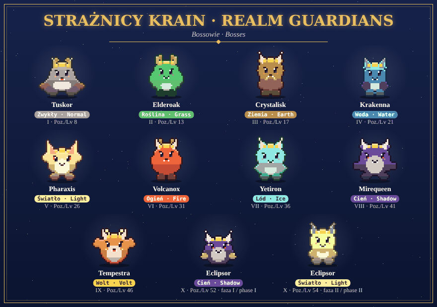

---

## Polski

### Układ map i areny bossów

Każda kraina ma własny algorytm budowy mapy (od 70×50 do 120×84 kafelków) i ręcznie zaprojektowaną arenę bossa.

| | Kraina | Układ mapy | Arena bossa | Mapa |
|---|---|---|---|---|
| I | Łąki Świtu | Otwarte pola, kręta rzeka z mostkami, staw, wioska na starcie | Krąg menhirów o zachodzie słońca | [podgląd](img/map-1.png) |
| II | Szepczący Las | Labirynt wąskich ścieżek, ukryte polany ze skarbami | Wnętrze pradawnego, pustego drzewa | [podgląd](img/map-2.png) |
| III | Kryształowe Jaskinie | Naturalne groty, tunele, podziemne jeziorka, ślepe korytarze ze skarbami | Katedra kryształów z tęczowymi promieniami | [podgląd](img/map-3.png) |
| IV | Wybrzeże Mew | Łańcuch wysp połączonych pomostami, laguny, skały w morzu | Wrak statku nad wirem w czasie burzy | [podgląd](img/map-4.png) |
| V | Pustynia Słońca | Wydmy, ruiny świątyń z komnatami, oaza, karawanowa droga | Komnata tronowa piramidy (spiralne wejście) | [podgląd](img/map-5.png) |
| VI | Wulkan Popiołów | Płaskowyże przecięte rzekami lawy, kamienne mosty, spiralna wspinaczka | Krater z jeziorem lawy | [podgląd](img/map-6.png) |
| VII | Mroźne Szczyty | Pięć tarasów z serpentynami, zamarznięte jeziora, jaskinie w klifach | Lodowy tron z zorzą polarną | [podgląd](img/map-7.png) |
| VIII | Nawiedzone Mokradła | Wysepki w bagnie, kładki, ruiny kapliczek | Ołtarz w ruinach kaplicy pod szkarłatnym księżycem | [podgląd](img/map-8.png) |
| IX | Wieża Niebios | Ok. 20 latających wysp na spirali, mosty z chmur | Szczyt wieży w oku burzy | [podgląd](img/map-9.png) |
| X | Cytadela Zmierzchu | Symetryczny zamek: sale, dziedzińce z fontannami, bramy zygzakiem | Sala tronowa z zaćmionym słońcem; faza II: wymiar światła | [podgląd](img/map-10.png) |

Dziesięć krain odblokowuje się po kolei: gdy pokonasz strażnika krainy, w jego miejscu otwiera się portal do następnej. Do każdej odblokowanej krainy możesz potem wrócić z kapliczki (**Podróż**) albo z menu tytułowego (**Wybór krainy**). Każda kraina ma 2 trenerów, bossa, kilka kapliczek, skrzynie, sklep, mieszkańców opowiadających legendy oraz własny utwór muzyczny. Mapy są generowane z ustalonego ziarna — każdy gracz widzi te same krainy.

Lewy obrazek to fragment prawdziwej mapy krainy (start gracza, kapliczki, mieszkańcy), prawy — tło walki w tej krainie. Grafiki wygenerowano bezpośrednio kodem gry (`gfx.js`, `mapgen.js`).

**Spis:** [I Łąki Świtu](#pl-1) · [II Szepczący Las](#pl-2) · [III Kryształowe Jaskinie](#pl-3) · [IV Wybrzeże Mew](#pl-4) · [V Pustynia Słońca](#pl-5) · [VI Wulkan Popiołów](#pl-6) · [VII Mroźne Szczyty](#pl-7) · [VIII Nawiedzone Mokradła](#pl-8) · [IX Wieża Niebios](#pl-9) · [X Cytadela Zmierzchu](#pl-10)

Poziomy w tabelach dotyczą normalnego poziomu trudności (na łatwym przeciwnicy mają ok. 15% słabsze statystyki, na trudnym 15% mocniejsze); nagrody w złocie to wartości bazowe (łatwy ×1,2, trudny ×0,9). Ostatnie stworzenie w drużynie trenera ma zawsze o 1 poziom więcej.

Przegląd wszystkich stworzeń: [img/creatures.png](img/creatures.png) · strażników: [img/bosses.png](img/bosses.png).

### I · Łąki Świtu

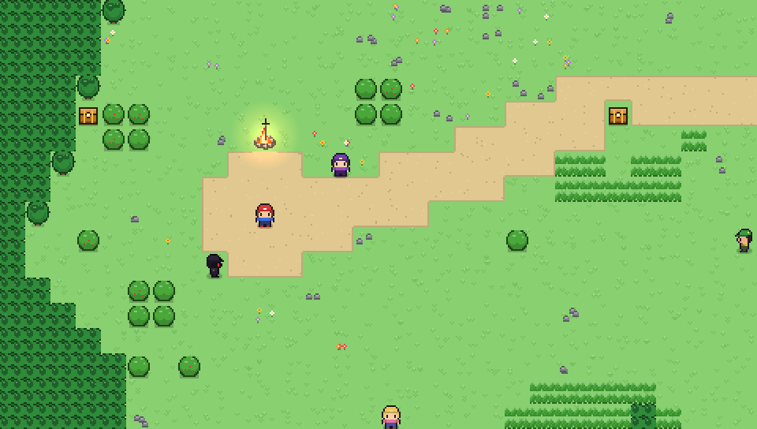 

> *Pierwsze promienie świtu kładą się na łąkach, lecz w trawie czai się niepokój. Strażnik krainy, Tuskor, ryczy w gniewie, którego nie rozumie.*

Łagodne, kwieciste łąki, nad którymi wiatr niesie płatki. Szerokie piaszczyste ścieżki, kępy wysokiej trawy, pierwsze kapliczki i pierwsze skrzynie — tu zaczyna się każda kronika. Kraina jest najmniejsza i najłatwiejsza, idealna do nauki walki i łapania.

| | |
|---|---|
| **Motyw** | łąka (`meadow`) · mapa 70×50 kafelków · Dostępna od początku gry. |
| **Poziomy** | dzikie Poz. 3–5, trenerzy Poz. 5–7, boss Poz. 8 · **zalecana drużyna: Poz. 4–10** |
| **Dzikie stworzenia** | Pipkit (Zwykły), Fluffet (Zwykły) → Fluffaroo (Poz. 18), Buzzle (Wolt) → Voltbuzz (Poz. 20), Sproutle (Roślina), Batwing (Cień) |
| **Trenerzy** | **Młody Kuba** — Pipkit 5, Buzzle 6 · nagroda 225 zł **Zielarka Ola** — Sproutle 6, Fluffet 6, Pipkit 7 · nagroda 260 zł |
| **Strażnik (boss)** | **Tuskor** — Zwykły, Poz. 8 (nagroda 480 zł); ataki: Szarża, Błysk, Skupienie. Słabość: brak. |
| **Muzyka** | Pogodny, skoczny marsz w tonacji durowej (118 BPM) — poranek wędrowca. |

**Wskazówki:**
- Tuskor jest typu Zwykłego: nic nie zadaje mu podwójnych obrażeń, ale nic też nie jest przeciw niemu osłabione. Liczy się poziom i bonus typu (STAB).
- Złap w trawie jedno-dwa stworzenia, aby mieć zapas na wypadek omdlenia startera — Pipkit i Fluffet łapią się bardzo łatwo.
- Zielarka Ola ma rośliny — Embrix (Ogień) ma tu przewagę, Aquapup musi uważać na Sproutle.

---

### II · Szepczący Las

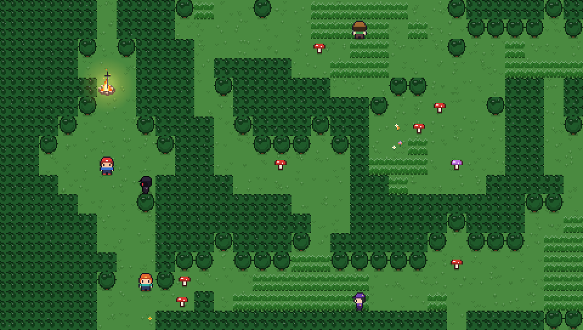 

> *Prastare drzewa szepczą między sobą o cieniu, który zakradł się do ich korzeni. Pradąb, ich opiekun, zamilkł.*

Gęsty, wilgotny bór, w którym między pniami unoszą się świetliki. Ścieżki wiją się między ścianami drzew, a w gąszczu kryją się skrzynie z miksturami. Las szepcze o cieniu, który zakradł się do korzeni.

| | |
|---|---|
| **Motyw** | las (`forest`) · mapa 76×54 kafelków · Odblokowanie: pokonaj strażnika krainy I. |
| **Poziomy** | dzikie Poz. 7–10, trenerzy Poz. 10–12, boss Poz. 13 · **zalecana drużyna: Poz. 8–15** |
| **Dzikie stworzenia** | Sproutle (Roślina), Mossnake (Roślina), Shroomy (Roślina), Buzzle (Wolt) → Voltbuzz (Poz. 20), Fluffet (Zwykły) → Fluffaroo (Poz. 18), Batwing (Cień) |
| **Trenerzy** | **Leśniczy Marek** — Mossnake 10, Buzzle 11 · nagroda 400 zł **Grzybiarka Basia** — Shroomy 11, Sproutle 11, Batwing 12 · nagroda 435 zł |
| **Strażnik (boss)** | **Elderoak** („Pradąb”) — Roślina, Poz. 13 (nagroda 780 zł); ataki: Szarża, Cięcie Liściem, Utwardzenie, Smagnięcie Pnączem. Słabość: Ogień, Lód; odporny na: Woda, Roślina, Ziemia. |
| **Muzyka** | Tajemnicza, kołysząca melodia w skali doryckiej (96 BPM). |

**Wskazówki:**
- Elderoak (Roślina) obawia się Ognia i Lodu; Woda i Ziemia zadają mu tylko połowę obrażeń. Embrix ma tu najłatwiej.
- Grzybiarka Basia i dzikie Shroomy usypiają Usypiającymi Zarodnikami — miej przy sobie Panaceum.
- Elderoak co jakiś czas używa Utwardzenia — Ryk albo seria mocnych ataków zbija jego obronę.

---

### III · Kryształowe Jaskinie

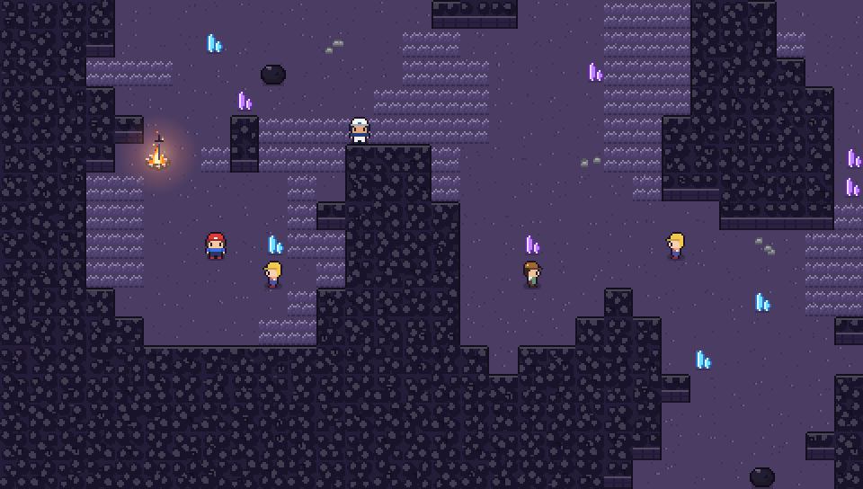 

> *W głębi skał kryształy pulsują chorym, fioletowym blaskiem. Ciemność oddycha tu razem z tobą.*

Ciemne groty o fioletowych ścianach, w których pulsują chore kryształy. Mapa jest przyciemniona — widzisz tylko krąg światła wokół siebie i blask kapliczek. Wąskie korytarze łączą komory pełne kryształowych narośli.

| | |
|---|---|
| **Motyw** | jaskinia (`cave`) · mapa 81×58 kafelków · Odblokowanie: pokonaj strażnika krainy II. |
| **Poziomy** | dzikie Poz. 11–14, trenerzy Poz. 14–16, boss Poz. 17 · **zalecana drużyna: Poz. 12–19** |
| **Dzikie stworzenia** | Gemmite (Ziemia), Rocklet (Ziemia) → Bouldron (Poz. 25), Batwing (Cień), Magmole (Ogień), Shroomy (Roślina) |
| **Trenerzy** | **Górnik Staszek** — Rocklet 14, Gemmite 15 · nagroda 540 zł **Grotołazka Ewa** — Batwing 15, Magmole 15, Gemmite 16 · nagroda 575 zł |
| **Strażnik (boss)** | **Crystalisk** — Ziemia, Poz. 17 (nagroda 1020 zł); ataki: Szarża, Rzut Kamykiem, Utwardzenie, Lawina Błota. Słabość: Woda, Roślina, Lód; odporny na: Ogień, Wolt. |
| **Muzyka** | Powolna (70 BPM), oszczędna, molowa — pojedyncze dźwięki jak krople kapiące w grocie. |

**Wskazówki:**
- Crystalisk (Ziemia) jest słaby na Wodę, Roślinę i Lód. Aquapup i Leafin błyszczą; ataki Embrixa (Ogień) są tu osłabione.
- Ataki ziemne (Rzut Kamykiem, Lawina Błota) zadają podwójne obrażenia stworzeniom Ognia i Wolta — uważaj z Embrixem i Buzzle.
- Gemmite i Rocklet mają wysoką obronę — atakuj je typami, na które są słabe, a nie samą siłą.

---

### IV · Wybrzeże Mew

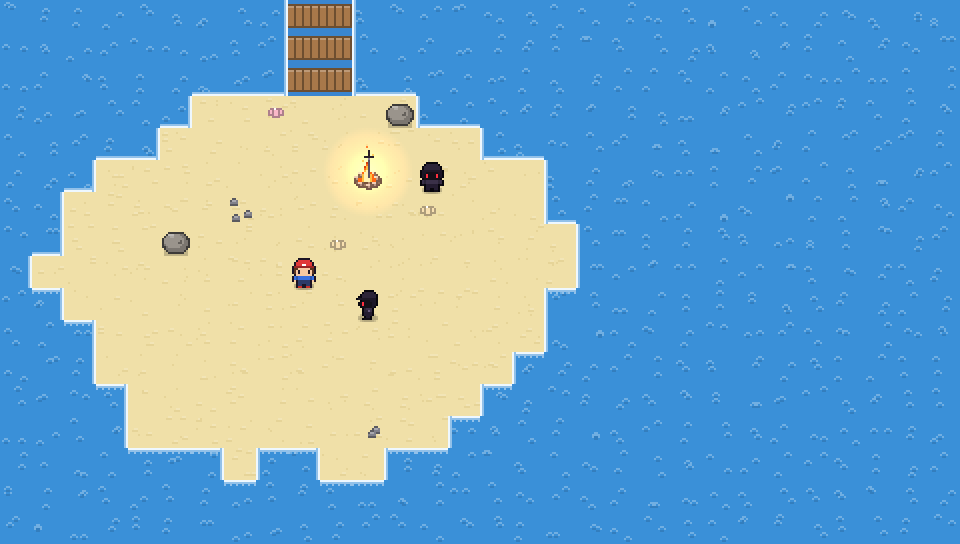 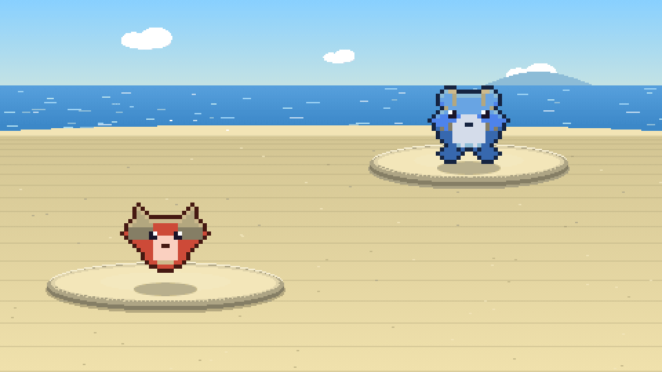

> *Fale biją o piaszczysty brzeg, a mewy krzyczą ostrzegawczo. Z głębin wynurza się coś ogromnego.*

Słoneczne plaże z muszlami, otoczone wodą zamiast ścian. Piaszczyste wysepki łączą się mieliznami, a mewy krzyczą ostrzegawczo, bo z głębin wynurza się coś ogromnego.

| | |
|---|---|
| **Motyw** | wybrzeże (`coast`) · mapa 87×61 kafelków · Odblokowanie: pokonaj strażnika krainy III. |
| **Poziomy** | dzikie Poz. 15–18, trenerzy Poz. 18–20, boss Poz. 21 · **zalecana drużyna: Poz. 16–23** |
| **Dzikie stworzenia** | Crabbit (Woda), Gullip (Woda), Shellby (Woda), Voltbuzz (Wolt), Fluffaroo (Zwykły) |
| **Trenerzy** | **Rybak Zbyszek** — Crabbit 18, Shellby 19 · nagroda 680 zł **Żeglarka Magda** — Gullip 19, Voltbuzz 19, Crabbit 20 · nagroda 715 zł |
| **Strażnik (boss)** | **Krakenna** — Woda, Poz. 21 (nagroda 1260 zł); ataki: Muśnięcie Cienia, Bąbelki, Skupienie, Wodny Strumień. Słabość: Roślina, Wolt; odporny na: Ogień, Woda, Ziemia. |
| **Muzyka** | Rozkołysana, żeglarska melodia w skali miksolidyjskiej, z lekkim swingiem (126 BPM). |

**Wskazówki:**
- Krakenna (Woda) jest słaba na Roślinę i Wolt. Leafin/Thornwing albo złapany Voltbuzz to najlepszy wybór.
- Krakenna atakuje też Muśnięciem Cienia — stworzenia Światła otrzymują od niego podwójne obrażenia.
- Od tej krainy sklepy sprzedają Wielkie Kule (×1,75) — idealne do łapania Voltbuzz i Fluffaroo. (Supermikstury i Wskrzeszenia są dostępne już od krainy III.)

---

### V · Pustynia Słońca

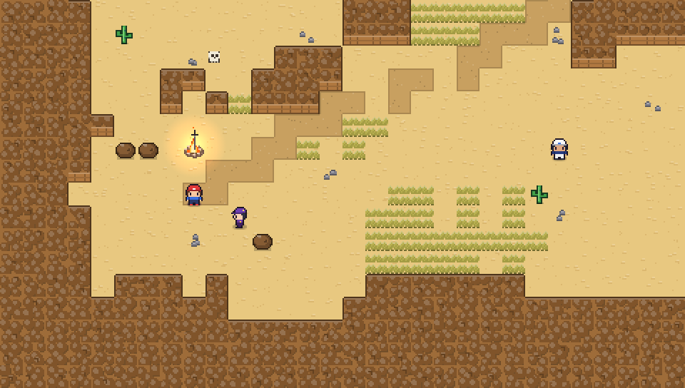 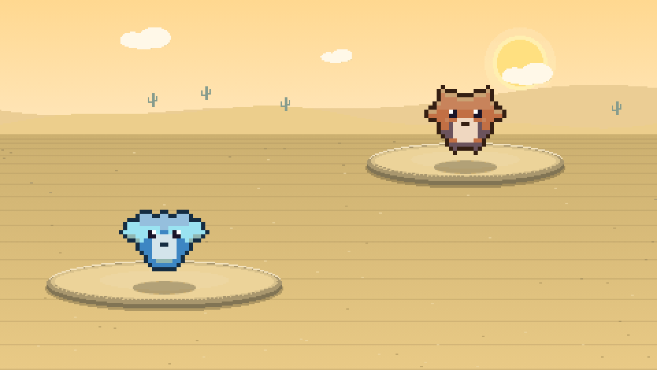

> *Słońce bezlitośnie pali piaski, a ruiny dawnych świątyń drżą w rozgrzanym powietrzu. Nawet światło może zbłądzić.*

Rozgrzane złote piaski, skalne ściany, kaktusy i wybielone czaszki. W drżącym powietrzu stoją ruiny dawnych świątyń, na których freski pamiętają Pierwszych Strażników.

| | |
|---|---|
| **Motyw** | pustynia (`desert`) · mapa 92×65 kafelków · Odblokowanie: pokonaj strażnika krainy IV. |
| **Poziomy** | dzikie Poz. 19–23, trenerzy Poz. 23–25, boss Poz. 26 · **zalecana drużyna: Poz. 20–28** |
| **Dzikie stworzenia** | Sandvip (Ziemia), Sunbeak (Światło), Cactoon (Roślina), Rocklet (Ziemia) → Bouldron (Poz. 25), Bouldron (Ziemia) |
| **Trenerzy** | **Wędrowiec Józef** — Sandvip 23, Cactoon 24 · nagroda 855 zł **Archeolożka Iza** — Sunbeak 24, Bouldron 24, Sandvip 25 · nagroda 890 zł |
| **Strażnik (boss)** | **Pharaxis** — Światło, Poz. 26 (nagroda 1560 zł); ataki: Uleczenie, Błysk Światła, Skupienie, Promienistość. Słabość: Cień; odporny na: Światło. |
| **Muzyka** | Gorąca, orientalna melodia w skali frygijskiej dominantowej (104 BPM). |

**Wskazówki:**
- Pharaxis (Światło) jest słaby wyłącznie na Cień i leczy się Uleczeniem — potrzebujesz mocnych, szybkich ataków, by przebić jego regenerację.
- Ataki Światła są słabe przeciw Światłu, więc Leafin/Thornwing nie powinien polegać na Błysku Światła.
- Sandvip (Ziemia) jest groźny dla ogniowych i woltowych stworzeń; Bouldron ma ogromną obronę.

---

### VI · Wulkan Popiołów

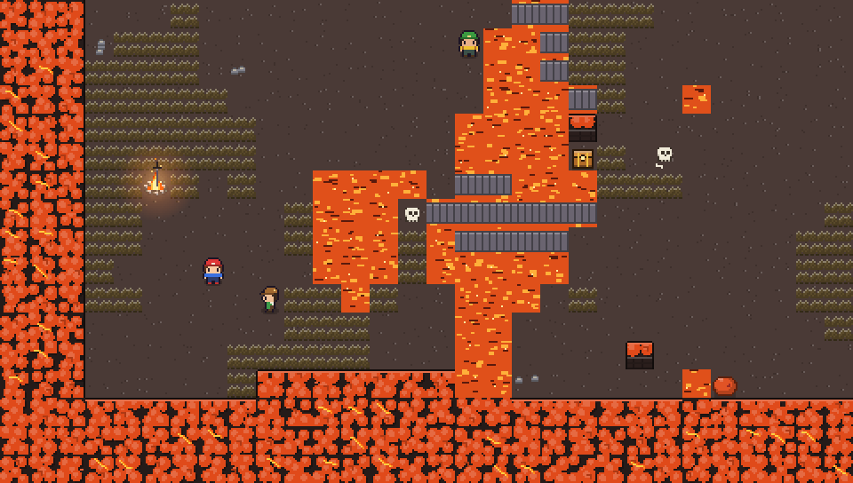 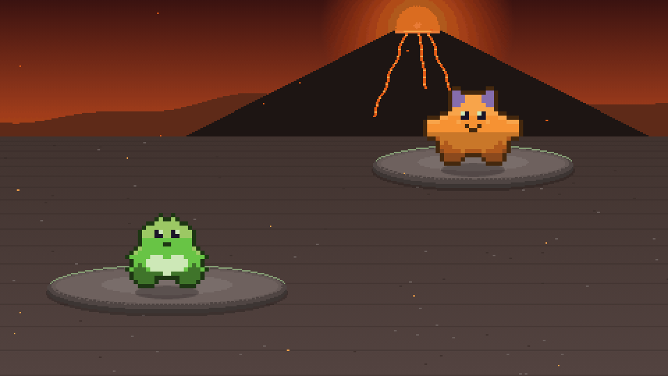

> *Niebo zasnuł popiół, a ziemia pęka od żaru. Serce wulkanu bije coraz szybciej.*

Popękana bazaltowa ziemia, rzeki lawy i niebo zasnute popiołem, z którego sypią się iskry. Ściany z zastygłej lawy żarzą się czerwienią, a serce wulkanu bije coraz szybciej.

| | |
|---|---|
| **Motyw** | wulkan (`volcano`) · mapa 98×69 kafelków · Odblokowanie: pokonaj strażnika krainy V. |
| **Poziomy** | dzikie Poz. 24–28, trenerzy Poz. 28–30, boss Poz. 31 · **zalecana drużyna: Poz. 25–33** |
| **Dzikie stworzenia** | Magmole (Ogień), Cindrake (Ogień), Ashling (Ogień), Bouldron (Ziemia), Gemmite (Ziemia) |
| **Trenerzy** | **Kowal Bogdan** — Magmole 28, Bouldron 29 · nagroda 1030 zł **Ogniomistrzyni Kasia** — Cindrake 29, Ashling 29, Magmole 30 · nagroda 1065 zł |
| **Strażnik (boss)** | **Volcanox** — Ogień, Poz. 31 (nagroda 1860 zł); ataki: Ryk, Iskra Żaru, Skupienie, Wybuch Płomieni. Słabość: Woda, Ziemia; odporny na: Ogień, Roślina, Lód. |
| **Muzyka** | Najszybszy utwór krain (150 BPM): nerwowy, ognisty, molowy. |

**Wskazówki:**
- Volcanox (Ogień) jest słaby na Wodę i Ziemię. Aquapup/Tidalisk to tu gwiazda drużyny.
- Ogień często oparza (–1/16 PŻ co turę i słabszy atak) — weź kilka Panaceów.
- Cindrake (Ogień, z atakami Cienia) to silne stworzenie warte złapania — przyda się w Mokradłach i Cytadeli.

---

### VII · Mroźne Szczyty

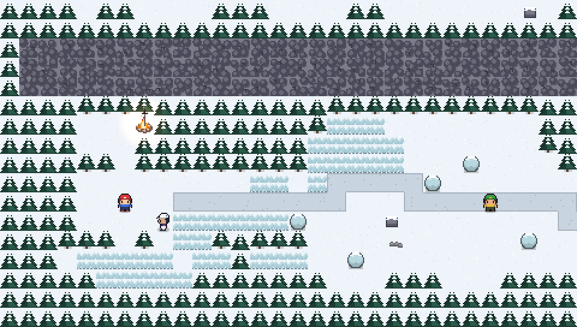 

> *Lodowy wiatr wyje między sosnami, a śnieg zasypuje dawne szlaki. Gdzieś na szczycie ryczy Yetiron.*

Zaśnieżone przełęcze otoczone ścianami sosen, z zamarzniętymi głazami i nieustannie padającym śniegiem. Lodowy wiatr wyje, a dawne szlaki giną pod zaspami.

| | |
|---|---|
| **Motyw** | śnieg (`snow`) · mapa 103×73 kafelków · Odblokowanie: pokonaj strażnika krainy VI. |
| **Poziomy** | dzikie Poz. 29–33, trenerzy Poz. 33–35, boss Poz. 36 · **zalecana drużyna: Poz. 30–38** |
| **Dzikie stworzenia** | Frostel (Lód), Snowpaw (Lód), Glacieron (Lód), Shellby (Woda), Haloth (Światło) |
| **Trenerzy** | **Alpinista Wojtek** — Snowpaw 33, Frostel 34 · nagroda 1205 zł **Pustelniczka Hania** — Glacieron 34, Haloth 34, Shellby 35 · nagroda 1240 zł |
| **Strażnik (boss)** | **Yetiron** — Lód, Poz. 36 (nagroda 2160 zł); ataki: Ryk, Zamieć, Skupienie, Lodowa Włócznia. Słabość: Ogień; odporny na: Roślina, Lód. |
| **Muzyka** | Rozmarzona, krystaliczna melodia w skali lidyjskiej (88 BPM). |

**Wskazówki:**
- Yetiron (Lód) ma tylko jedną słabość: Ogień. Embrix/Pyrhound/Infernyx albo złapany Cindrake to klucz do zwycięstwa.
- Ataki lodowe mrożą przeciwnika na 1–2 tury — Panaceum rozmraża. Stworzenia Lodu są odporne na zamrożenie.
- Yetiron używa Ryku, który obniża twoją obronę — nie przeciągaj walki. Od tej krainy sklep sprzedaje Eliksir Pełni i Kulę Zenitu (×2,5).

---

### VIII · Nawiedzone Mokradła

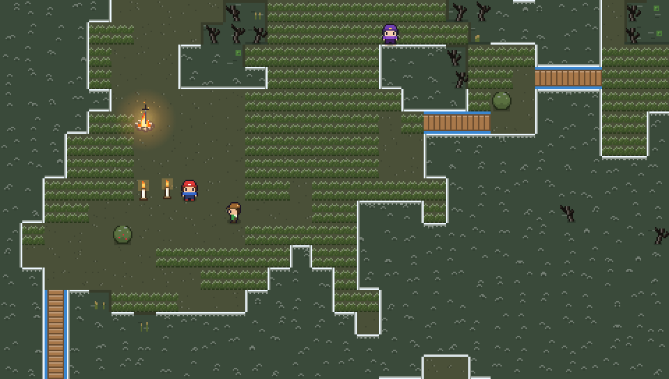 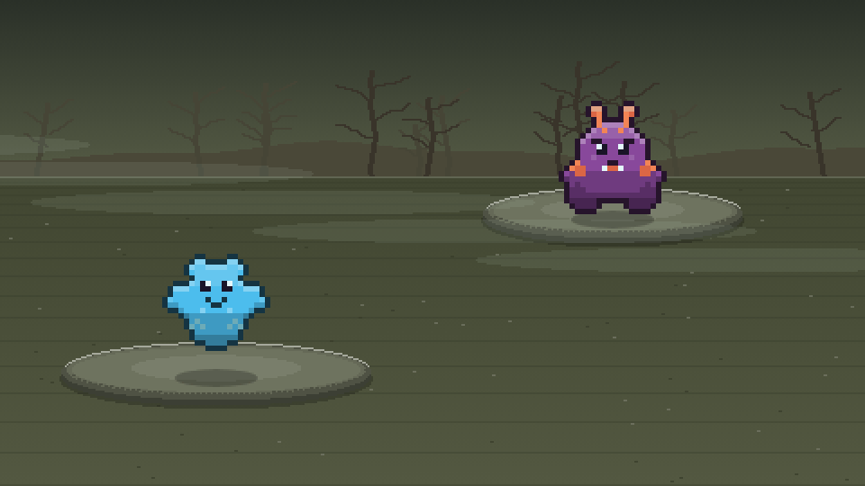

> *Mgła kłębi się nad czarną wodą, a martwe drzewa wyciągają ku tobie gałęzie. Tu Zaćmienie jest najsilniejsze.*

Czarna woda, martwe drzewa, mgła snująca się nad bagnem, świece i czaszki. Kraina jest ciemna jak jaskinie — to tutaj Zaćmienie jest najsilniejsze.

| | |
|---|---|
| **Motyw** | mokradła (`mire`) · mapa 109×76 kafelków · Odblokowanie: pokonaj strażnika krainy VII. |
| **Poziomy** | dzikie Poz. 34–38, trenerzy Poz. 38–40, boss Poz. 41 · **zalecana drużyna: Poz. 35–43** |
| **Dzikie stworzenia** | Wispyre (Cień), Ghoulip (Cień), Bogtoad (Woda), Mossnake (Roślina), Shroomy (Roślina), Duskknight (Cień) |
| **Trenerzy** | **Medium Lucjan** — Wispyre 38, Ghoulip 39 · nagroda 1380 zł **Wiedźma Jadwiga** — Bogtoad 39, Shroomy 39, Duskknight 40 · nagroda 1415 zł |
| **Strażnik (boss)** | **Mirequeen** („Królowa Mokradeł”) — Cień, Poz. 41 (nagroda 2460 zł); ataki: Wodny Strumień, Mroczny Puls, Skupienie, Nocny Pazur. Słabość: Światło; odporny na: Cień. |
| **Muzyka** | Upiorna, powolna melodia w molu harmonicznym (78 BPM). |

**Wskazówki:**
- Królowa Mokradeł (Cień) jest słaba tylko na Światło. Thornwing/Sylvagon (ataki Światła), Haloth czy Zephyra są tu na wagę złota.
- Mroczny Puls zatruwa (–1/8 PŻ co turę) — trucizna jest groźniejsza od oparzenia. Stworzenia Cienia są na nią odporne.
- Wiele tutejszych stworzeń używa Toksyny; zapas Panaceów to obowiązek.

---

### IX · Wieża Niebios

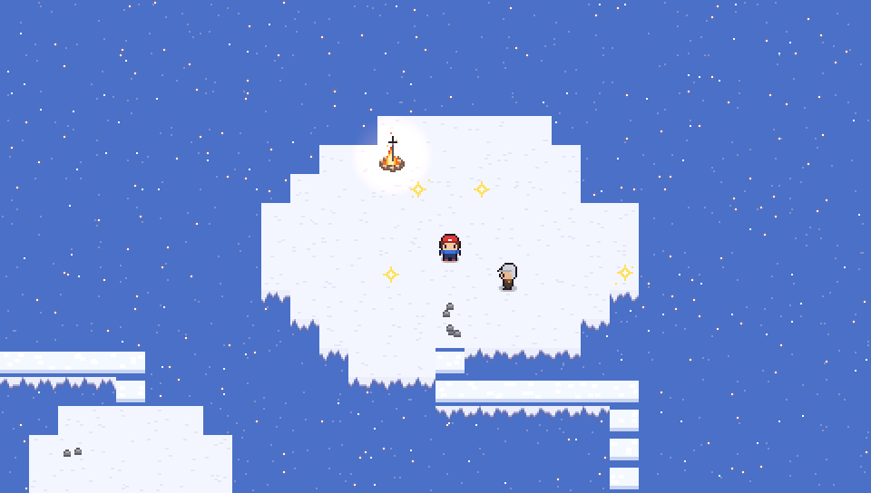 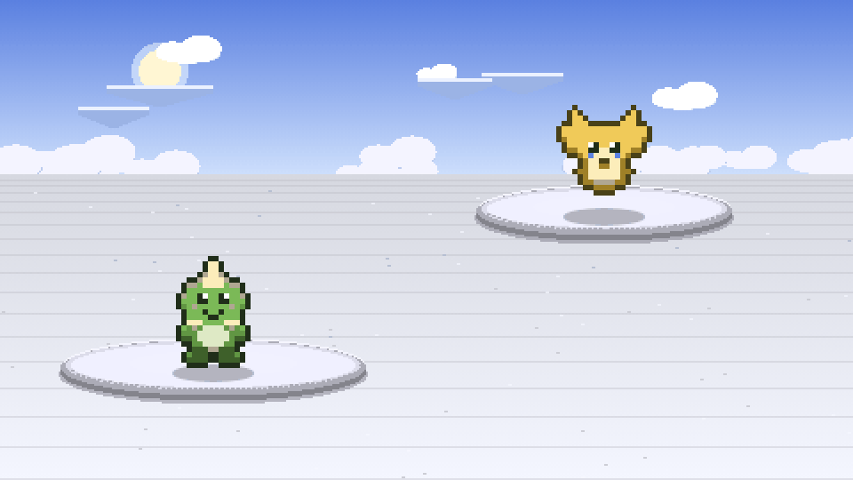

> *Kamienne mosty wiszą nad przepaścią chmur, a pioruny rozdzierają niebo. Burza nie ustaje od czasu Zaćmienia.*

Białe kamienne wyspy i złote mosty zawieszone nad otchłanią chmur, wśród migoczących gwiazd. Krawędzie wysp opadają w błękitną pustkę, a burza nie ustaje od czasu Zaćmienia.

| | |
|---|---|
| **Motyw** | niebo (`sky`) · mapa 114×80 kafelków · Odblokowanie: pokonaj strażnika krainy VIII. |
| **Poziomy** | dzikie Poz. 39–43, trenerzy Poz. 43–45, boss Poz. 46 · **zalecana drużyna: Poz. 40–48** |
| **Dzikie stworzenia** | Zephyra (Światło), Stormane (Wolt), Nimbo (Woda), Gullip (Woda), Voltbuzz (Wolt), Haloth (Światło) |
| **Trenerzy** | **Lotnik Tadeusz** — Zephyra 43, Gullip 44 · nagroda 1555 zł **Burzowa Zosia** — Stormane 44, Nimbo 44, Voltbuzz 45 · nagroda 1590 zł |
| **Strażnik (boss)** | **Tempestra** — Wolt, Poz. 46 (nagroda 2760 zł); ataki: Promienistość, Huk Gromu, Skupienie, Grom Wolt. Słabość: Ziemia; odporny na: Wolt. |
| **Muzyka** | Podniosła, lotna melodia durowa (132 BPM), pełna wiatru. |

**Wskazówki:**
- Tempestra (Wolt) jest słaba tylko na Ziemię — Embrix i jego ewolucje znają Lawinę Błota i Wstrząs; Bouldron i Glacieron też się sprawdzą.
- Ataki Wolt paraliżują (połowa szybkości i 25% szansy na stratę tury). Stworzenia Wolt są na paraliż odporne.
- Woda jest tu w niebezpieczeństwie — Huk Gromu zadaje jej podwójne obrażenia.

---

### X · Cytadela Zmierzchu

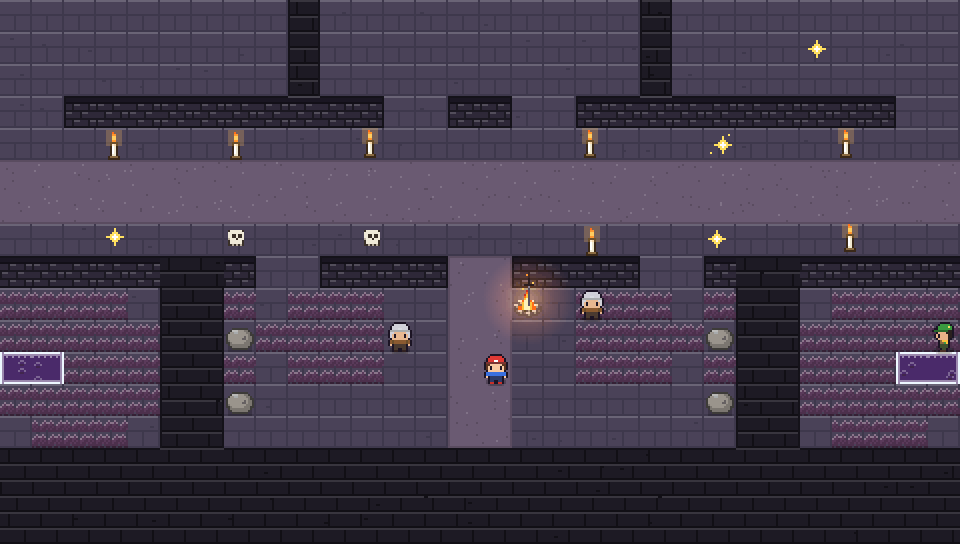 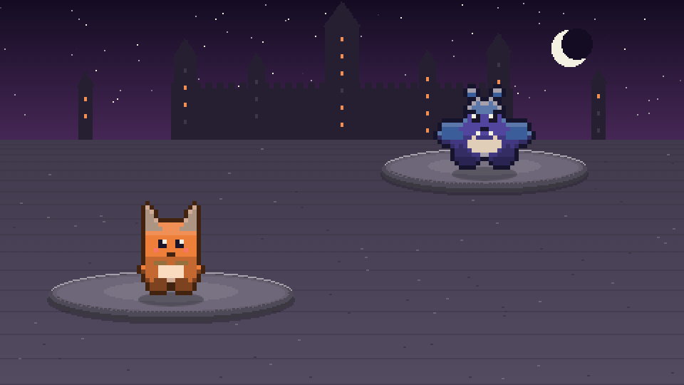

> *Czarne mury Cytadeli wchłaniają każdy promień. W jej sercu Eclipsor czeka na ostatniego Strażnika.*

Czarne ceglane mury, korytarze oświetlone świecami, czaszki i gwiazdy na posadzce. Cytadela wchłania każdy promień — widzisz tylko krąg światła. Ostatnia kapliczka płonie tuż przed tronem.

| | |
|---|---|
| **Motyw** | cytadela (`citadel`) · mapa 120×84 kafelków · Odblokowanie: pokonaj strażnika krainy IX. |
| **Poziomy** | dzikie Poz. 44–48, trenerzy Poz. 48–50, boss Poz. 52/54 · **zalecana drużyna: Poz. 45–54** |
| **Dzikie stworzenia** | Duskknight (Cień), Haloth (Światło), Voidling (Cień), Cindrake (Ogień), Glacieron (Lód), Stormane (Wolt) |
| **Trenerzy** | **Rycerz Cienia Roch** — Duskknight 48, Voidling 49 · nagroda 1730 zł **Upadła Strażniczka Wanda** — Haloth 49, Cindrake 49, Glacieron 50 · nagroda 1765 zł |
| **Strażnik (boss)** | **Eclipsor** (faza I) — Cień, Poz. 52 (nagroda 3120 zł); ataki: Zaćmienie, Mroczny Puls, Rozbłysk Słońca, Nocny Pazur. Słabość: Światło; odporny na: Cień. **Eclipsor** (faza II) — Światło, Poz. 54; ataki: Uleczenie, Rozbłysk Słońca, Mroczny Puls, Zaćmienie. Słabość: Cień; odporny na: Światło. |
| **Muzyka** | Ciężki, epicki, złowrogi utwór w niskim rejestrze (108 BPM). W walce finałowej gra osobny motyw. |

**Wskazówki:**
- Faza I: Eclipsor (Cień) jest słaby na Światło. Faza II: Eclipsor (Światło) jest słaby na Cień. Potrzebujesz w drużynie obu typów ataków!
- Zaćmienie (moc 120) to najsilniejszy ruch w grze. W fazie II Eclipsor leczy się Uleczeniem.
- Zabierz Eliksiry Pełni i Wskrzeszenia. Odpocznij przy ostatniej kapliczce przed tronem — zapisze grę tuż przed walką.

---

## English

### Map layouts and boss arenas

Every realm has its own map-building algorithm (from 70×50 up to 120×84 tiles) and a hand-crafted boss arena.

| | Realm | Map layout | Boss arena | Map |
|---|---|---|---|---|
| I | Łąki Świtu | Open fields, a winding river with bridges, a pond, a starting village | Stone circle at sunset | [preview](img/map-1.png) |
| II | Szepczący Las | A maze of narrow trails, hidden treasure glades | Inside an ancient hollow tree | [preview](img/map-2.png) |
| III | Kryształowe Jaskinie | Natural caverns, tunnels, underground pools, treasure dead ends | Crystal cathedral with prismatic beams | [preview](img/map-3.png) |
| IV | Wybrzeże Mew | A chain of islands linked by piers, lagoons, sea rocks | Shipwreck above a whirlpool in a storm | [preview](img/map-4.png) |
| V | Pustynia Słońca | Dunes, temple ruins with chambers, an oasis, a caravan road | Pyramid throne chamber (spiral entrance) | [preview](img/map-5.png) |
| VI | Wulkan Popiołów | Plateaus split by lava rivers, stone bridges, a spiral climb | Crater with a lava lake | [preview](img/map-6.png) |
| VII | Mroźne Szczyty | Five terraces with switchbacks, frozen lakes, cliff caves | Frozen throne under the aurora | [preview](img/map-7.png) |
| VIII | Nawiedzone Mokradła | Swamp islets, boardwalks, ruined shrines | Altar in a ruined chapel under a crimson moon | [preview](img/map-8.png) |
| IX | Wieża Niebios | About 20 floating islands on a spiral, cloud bridges | Spire top in the eye of the storm | [preview](img/map-9.png) |
| X | Cytadela Zmierzchu | A symmetrical castle: halls, fountain courtyards, zig-zag gates | Throne room with an eclipsed sun; phase II: a realm of light | [preview](img/map-10.png) |

The ten realms unlock one after another: when you defeat a realm's guardian, a portal to the next realm opens where it stood. You can return to any unlocked realm from a shrine (**Travel**) or from the title menu (**Realm select**). Every realm has 2 trainers, a boss, several shrines, chests, a shop, residents who tell legends, and its own music track. Maps are generated from a fixed seed — every player sees the same realms.

The left picture is a crop of the realm's real map (player start, shrines, residents); the right one is the realm's battle backdrop. The images were rendered directly by the game's own code (`gfx.js`, `mapgen.js`).

**Contents:** [I Dawnlight Meadows](#en-1) · [II Whispering Woods](#en-2) · [III Crystal Caverns](#en-3) · [IV Gullwing Coast](#en-4) · [V Sunscar Desert](#en-5) · [VI Ashen Volcano](#en-6) · [VII Frostpeak Heights](#en-7) · [VIII Haunted Mire](#en-8) · [IX Skyward Spire](#en-9) · [X Twilight Citadel](#en-10)

Levels in the tables refer to Normal difficulty (on Easy opponents have about 15% weaker stats, on Hard 15% stronger); gold rewards are base values (Easy ×1.2, Hard ×0.9). The last creature in a trainer's team is always 1 level higher.

Overview of all creatures: [img/creatures.png](img/creatures.png) · guardians: [img/bosses.png](img/bosses.png).

### I · Dawnlight Meadows

 

> *The first rays of dawn spill across the meadows, yet unease stirs in the grass. Tuskor, the land's guardian, bellows in a rage it cannot understand.*

Gentle flower meadows with petals drifting on the wind. Wide sandy paths, patches of tall grass, the first shrines and the first chests — every chronicle begins here. It is the smallest and easiest realm, perfect for learning to fight and catch.

| | |
|---|---|
| **Theme** | meadow (`meadow`) · map 70×50 tiles · Available from the start. |
| **Levels** | wild Lv 3–5, trainers Lv 5–7, boss Lv 8 · **recommended team: Lv 4–10** |
| **Wild creatures** | Pipkit (Normal), Fluffet (Normal) → Fluffaroo (Lv 18), Buzzle (Volt) → Voltbuzz (Lv 20), Sproutle (Grass), Batwing (Shadow) |
| **Trainers** | **Youngster Kuba** — Pipkit 5, Buzzle 6 · reward 225 G **Herbalist Ola** — Sproutle 6, Fluffet 6, Pipkit 7 · reward 260 G |
| **Guardian (boss)** | **Tuskor** — Normal, Lv 8 (reward 480 G); moves: Tackle, Quick Dash, Focus. Weak to: none. |
| **Music** | A cheerful, bouncy major-key march (118 BPM) — a traveller's morning. |

**Tips:**
- Tuskor is Normal-type: nothing hits it super-effectively, but nothing is resisted either. Level and same-type bonus (STAB) are what count.
- Catch one or two creatures in the grass as backup in case your starter faints — Pipkit and Fluffet are very easy to catch.
- Herbalist Ola uses plants — Embrix (Fire) has the edge, Aquapup should beware of Sproutle.

---

### II · Whispering Woods

 

> *Ancient trees whisper of a shadow that crept into their roots. Elderoak, their keeper, has fallen silent.*

A dense, damp forest where fireflies drift between the trunks. Paths wind between walls of trees, and potion-filled chests hide in the thicket. The woods whisper of a shadow that crept into their roots.

| | |
|---|---|
| **Theme** | forest (`forest`) · map 76×54 tiles · Unlock: defeat the guardian of realm I. |
| **Levels** | wild Lv 7–10, trainers Lv 10–12, boss Lv 13 · **recommended team: Lv 8–15** |
| **Wild creatures** | Sproutle (Grass), Mossnake (Grass), Shroomy (Grass), Buzzle (Volt) → Voltbuzz (Lv 20), Fluffet (Normal) → Fluffaroo (Lv 18), Batwing (Shadow) |
| **Trainers** | **Ranger Marek** — Mossnake 10, Buzzle 11 · reward 400 G **Forager Basia** — Shroomy 11, Sproutle 11, Batwing 12 · reward 435 G |
| **Guardian (boss)** | **Elderoak** — Grass, Lv 13 (reward 780 G); moves: Tackle, Leaf Cut, Harden, Vine Lash. Weak to: Fire, Ice; resists: Water, Grass, Earth. |
| **Music** | A mysterious, swaying tune in the Dorian mode (96 BPM). |

**Tips:**
- Elderoak (Grass) fears Fire and Ice; Water and Earth deal only half damage to it. Embrix has the easiest time here.
- Forager Basia and wild Shroomy use Sleep Spore — keep a Cure-All handy.
- Elderoak uses Harden from time to time — Roar or a string of strong attacks will wear its defense down.

---

### III · Crystal Caverns

 

> *Deep within the rock, crystals pulse with a sickly violet glow. Here the darkness breathes along with you.*

Dark grottoes with violet walls where sickly crystals pulse. The map is darkened — you see only a circle of light around you and the glow of the shrines. Narrow tunnels link chambers full of crystal growths.

| | |
|---|---|
| **Theme** | cave (`cave`) · map 81×58 tiles · Unlock: defeat the guardian of realm II. |
| **Levels** | wild Lv 11–14, trainers Lv 14–16, boss Lv 17 · **recommended team: Lv 12–19** |
| **Wild creatures** | Gemmite (Earth), Rocklet (Earth) → Bouldron (Lv 25), Batwing (Shadow), Magmole (Fire), Shroomy (Grass) |
| **Trainers** | **Miner Staszek** — Rocklet 14, Gemmite 15 · reward 540 G **Spelunker Ewa** — Batwing 15, Magmole 15, Gemmite 16 · reward 575 G |
| **Guardian (boss)** | **Crystalisk** — Earth, Lv 17 (reward 1020 G); moves: Tackle, Pebble Toss, Harden, Mudslide. Weak to: Water, Grass, Ice; resists: Fire, Volt. |
| **Music** | Slow (70 BPM), sparse and minor — single notes like water dripping in a grotto. |

**Tips:**
- Crystalisk (Earth) is weak to Water, Grass and Ice. Aquapup and Leafin shine; Embrix's Fire attacks are resisted here.
- Earth attacks (Pebble Toss, Mudslide) deal double damage to Fire and Volt creatures — be careful with Embrix and Buzzle.
- Gemmite and Rocklet have high defense — hit them with types they are weak to rather than raw power.

---

### IV · Gullwing Coast

 

> *Waves pound the sandy shore and gulls cry in warning. Something vast is rising from the deep.*

Sunny beaches strewn with shells, bounded by water instead of walls. Sandy islets are linked by shallows, and the gulls cry in warning, for something vast is rising from the deep.

| | |
|---|---|
| **Theme** | coast (`coast`) · map 87×61 tiles · Unlock: defeat the guardian of realm III. |
| **Levels** | wild Lv 15–18, trainers Lv 18–20, boss Lv 21 · **recommended team: Lv 16–23** |
| **Wild creatures** | Crabbit (Water), Gullip (Water), Shellby (Water), Voltbuzz (Volt), Fluffaroo (Normal) |
| **Trainers** | **Fisherman Zbyszek** — Crabbit 18, Shellby 19 · reward 680 G **Sailor Magda** — Gullip 19, Voltbuzz 19, Crabbit 20 · reward 715 G |
| **Guardian (boss)** | **Krakenna** — Water, Lv 21 (reward 1260 G); moves: Shade Touch, Bubble, Focus, Aqua Jet. Weak to: Grass, Volt; resists: Fire, Water, Earth. |
| **Music** | A rolling, sea-shanty tune in the Mixolydian mode with a light swing (126 BPM). |

**Tips:**
- Krakenna (Water) is weak to Grass and Volt. Leafin/Thornwing or a caught Voltbuzz is the best pick.
- Krakenna also uses Shade Touch — Light creatures take double damage from it.
- From this realm on shops sell Great Orbs (×1.75) — ideal for catching Voltbuzz and Fluffaroo. (Super Potions and Revives are available from realm III.)

---

### V · Sunscar Desert

 

> *The sun scorches the sands without mercy, and old temple ruins shimmer in the heat. Even light can lose its way.*

Scorching golden sands, rock walls, cacti and bleached skulls. Ruins of ancient temples shimmer in the heat, their murals remembering the First Wardens.

| | |
|---|---|
| **Theme** | desert (`desert`) · map 92×65 tiles · Unlock: defeat the guardian of realm IV. |
| **Levels** | wild Lv 19–23, trainers Lv 23–25, boss Lv 26 · **recommended team: Lv 20–28** |
| **Wild creatures** | Sandvip (Earth), Sunbeak (Light), Cactoon (Grass), Rocklet (Earth) → Bouldron (Lv 25), Bouldron (Earth) |
| **Trainers** | **Wanderer Józef** — Sandvip 23, Cactoon 24 · reward 855 G **Archaeologist Iza** — Sunbeak 24, Bouldron 24, Sandvip 25 · reward 890 G |
| **Guardian (boss)** | **Pharaxis** — Light, Lv 26 (reward 1560 G); moves: Mend, Glint, Focus, Radiance. Weak to: Shadow; resists: Light. |
| **Music** | A hot, exotic melody in the Phrygian dominant scale (104 BPM). |

**Tips:**
- Pharaxis (Light) is weak only to Shadow and heals itself with Mend — you need strong, fast attacks to outpace its healing.
- Light attacks are resisted by Light, so Leafin/Thornwing should not rely on Glint.
- Sandvip (Earth) is dangerous to Fire and Volt creatures; Bouldron has huge defense.

---

### VI · Ashen Volcano

 

> *Ash veils the sky and the ground cracks with heat. The volcano's heart beats ever faster.*

Cracked basalt ground, rivers of lava and an ash-veiled sky raining embers. Walls of cooled lava glow red, and the volcano's heart beats ever faster.

| | |
|---|---|
| **Theme** | volcano (`volcano`) · map 98×69 tiles · Unlock: defeat the guardian of realm V. |
| **Levels** | wild Lv 24–28, trainers Lv 28–30, boss Lv 31 · **recommended team: Lv 25–33** |
| **Wild creatures** | Magmole (Fire), Cindrake (Fire), Ashling (Fire), Bouldron (Earth), Gemmite (Earth) |
| **Trainers** | **Smith Bogdan** — Magmole 28, Bouldron 29 · reward 1030 G **Firedancer Kasia** — Cindrake 29, Ashling 29, Magmole 30 · reward 1065 G |
| **Guardian (boss)** | **Volcanox** — Fire, Lv 31 (reward 1860 G); moves: Roar, Ember, Focus, Flame Burst. Weak to: Water, Earth; resists: Fire, Grass, Ice. |
| **Music** | The fastest realm track (150 BPM): restless, fiery, minor-key. |

**Tips:**
- Volcanox (Fire) is weak to Water and Earth. Aquapup/Tidalisk is the team's star here.
- Fire often burns (–1/16 HP per turn and weaker attacks) — bring several Cure-Alls.
- Cindrake (Fire with Shadow moves) is a strong creature worth catching — it pays off in the Mire and the Citadel.

---

### VII · Frostpeak Heights

 

> *An icy wind howls among the pines, and snow buries the old trails. Somewhere on the summit, Yetiron roars.*

Snowy passes walled by pine forests, with frozen boulders and endless falling snow. An icy wind howls and the old trails vanish beneath the drifts.

| | |
|---|---|
| **Theme** | snow (`snow`) · map 103×73 tiles · Unlock: defeat the guardian of realm VI. |
| **Levels** | wild Lv 29–33, trainers Lv 33–35, boss Lv 36 · **recommended team: Lv 30–38** |
| **Wild creatures** | Frostel (Ice), Snowpaw (Ice), Glacieron (Ice), Shellby (Water), Haloth (Light) |
| **Trainers** | **Climber Wojtek** — Snowpaw 33, Frostel 34 · reward 1205 G **Hermit Hania** — Glacieron 34, Haloth 34, Shellby 35 · reward 1240 G |
| **Guardian (boss)** | **Yetiron** — Ice, Lv 36 (reward 2160 G); moves: Roar, Blizzard, Focus, Ice Lance. Weak to: Fire; resists: Grass, Ice. |
| **Music** | A dreamy, crystalline tune in the Lydian mode (88 BPM). |

**Tips:**
- Yetiron (Ice) has a single weakness: Fire. Embrix/Pyrhound/Infernyx or a caught Cindrake is the key to victory.
- Ice attacks freeze the target for 1–2 turns — a Cure-All thaws it. Ice creatures cannot be frozen.
- Yetiron uses Roar, which lowers your defense — do not let the fight drag on. From this realm on the shop sells the Max Elixir and the Zenith Orb (×2.5).

---

### VIII · Haunted Mire

 

> *Fog coils above black water, and dead trees reach for you with their branches. Here the Eclipse is strongest.*

Black water, dead trees, fog crawling over the bog, candles and skulls. The realm is as dark as the caverns — here the Eclipse is strongest.

| | |
|---|---|
| **Theme** | mire (`mire`) · map 109×76 tiles · Unlock: defeat the guardian of realm VII. |
| **Levels** | wild Lv 34–38, trainers Lv 38–40, boss Lv 41 · **recommended team: Lv 35–43** |
| **Wild creatures** | Wispyre (Shadow), Ghoulip (Shadow), Bogtoad (Water), Mossnake (Grass), Shroomy (Grass), Duskknight (Shadow) |
| **Trainers** | **Medium Lucjan** — Wispyre 38, Ghoulip 39 · reward 1380 G **Witch Jadwiga** — Bogtoad 39, Shroomy 39, Duskknight 40 · reward 1415 G |
| **Guardian (boss)** | **Mirequeen** (“the Mire Queen”) — Shadow, Lv 41 (reward 2460 G); moves: Aqua Jet, Dark Pulse, Focus, Night Claw. Weak to: Light; resists: Shadow. |
| **Music** | A ghostly, slow melody in the harmonic minor (78 BPM). |

**Tips:**
- The Mire Queen (Shadow) is weak only to Light. Thornwing/Sylvagon (Light moves), Haloth or Zephyra are worth their weight in gold here.
- Dark Pulse poisons (–1/8 HP per turn) — poison is nastier than burn. Shadow creatures are immune to it.
- Many creatures here use Toxin; a stock of Cure-Alls is a must.

---

### IX · Skyward Spire

 

> *Stone bridges hang above an abyss of clouds, and lightning tears the sky apart. The storm has raged since the Eclipse.*

White stone islands and golden bridges suspended above an abyss of clouds among twinkling stars. The island edges drop into a blue void, and the storm has raged since the Eclipse.

| | |
|---|---|
| **Theme** | sky (`sky`) · map 114×80 tiles · Unlock: defeat the guardian of realm VIII. |
| **Levels** | wild Lv 39–43, trainers Lv 43–45, boss Lv 46 · **recommended team: Lv 40–48** |
| **Wild creatures** | Zephyra (Light), Stormane (Volt), Nimbo (Water), Gullip (Water), Voltbuzz (Volt), Haloth (Light) |
| **Trainers** | **Aviator Tadeusz** — Zephyra 43, Gullip 44 · reward 1555 G **Stormcaller Zosia** — Stormane 44, Nimbo 44, Voltbuzz 45 · reward 1590 G |
| **Guardian (boss)** | **Tempestra** — Volt, Lv 46 (reward 2760 G); moves: Radiance, Thunderclap, Focus, Volt Bolt. Weak to: Earth; resists: Volt. |
| **Music** | A soaring, airy major-key melody (132 BPM), full of wind. |

**Tips:**
- Tempestra (Volt) is weak only to Earth — Embrix and its evolutions learn Mudslide and Quake; Bouldron and Glacieron work well too.
- Volt attacks paralyze (half speed and a 25% chance to lose the turn). Volt creatures are immune to paralysis.
- Water creatures are in danger here — Thunderclap deals them double damage.

---

### X · Twilight Citadel

 

> *The Citadel's black walls drink in every ray. At its heart, Eclipsor awaits the last Warden.*

Black brick walls, candlelit corridors, skulls and stars on the floor. The Citadel drinks in every ray — you see only a circle of light. The last shrine burns just before the throne.

| | |
|---|---|
| **Theme** | citadel (`citadel`) · map 120×84 tiles · Unlock: defeat the guardian of realm IX. |
| **Levels** | wild Lv 44–48, trainers Lv 48–50, boss Lv 52/54 · **recommended team: Lv 45–54** |
| **Wild creatures** | Duskknight (Shadow), Haloth (Light), Voidling (Shadow), Cindrake (Fire), Glacieron (Ice), Stormane (Volt) |
| **Trainers** | **Shadow Knight Roch** — Duskknight 48, Voidling 49 · reward 1730 G **Fallen Warden Wanda** — Haloth 49, Cindrake 49, Glacieron 50 · reward 1765 G |
| **Guardian (boss)** | **Eclipsor** (phase I) — Shadow, Lv 52 (reward 3120 G); moves: Eclipse, Dark Pulse, Sunflare, Night Claw. Weak to: Light; resists: Shadow. **Eclipsor** (phase II) — Light, Lv 54; moves: Mend, Sunflare, Dark Pulse, Eclipse. Weak to: Shadow; resists: Light. |
| **Music** | A heavy, epic, ominous track in a low register (108 BPM). The final battle has its own theme. |

**Tips:**
- Phase I: Eclipsor (Shadow) is weak to Light. Phase II: Eclipsor (Light) is weak to Shadow. You need both attack types in your team!
- Eclipse (power 120) is the strongest move in the game. In phase II Eclipsor heals itself with Mend.
- Bring Max Elixirs and Revives. Rest at the last shrine before the throne — it saves the game right before the fight.

